# LocalChords

**English** · [Français](README.md)

A clear chord grid that follows playback, on your Windows PC, with guitar and piano diagrams for the chord
being played. Drop in a song: the chords appear bar by bar and scroll as you listen. Everything happens on
your computer: the audio is never sent anywhere, no account, no subscription.

**[⬇ Download the latest version](https://github.com/tadikwa/LocalChords/releases/latest)** (Windows 10
or 11, 64-bit, free, offline). The interface is in **English and French** (1.7).

## LocalChords in one minute

[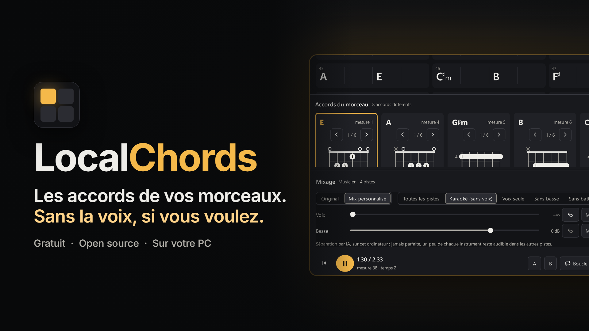](https://youtu.be/tmFD1hkFcLw)

**[▶ Watch the video on YouTube](https://youtu.be/tmFD1hkFcLw)** (music only, on-screen text in French;
an English translation of it as subtitles: [docs/video/LocalChords-presentation.en.srt](docs/video/LocalChords-presentation.en.srt)).

See how LocalChords works out a song's chords, shows synced lyrics, and separates the vocals, drums and bass
so you can play or sing in their place.

## Screenshots

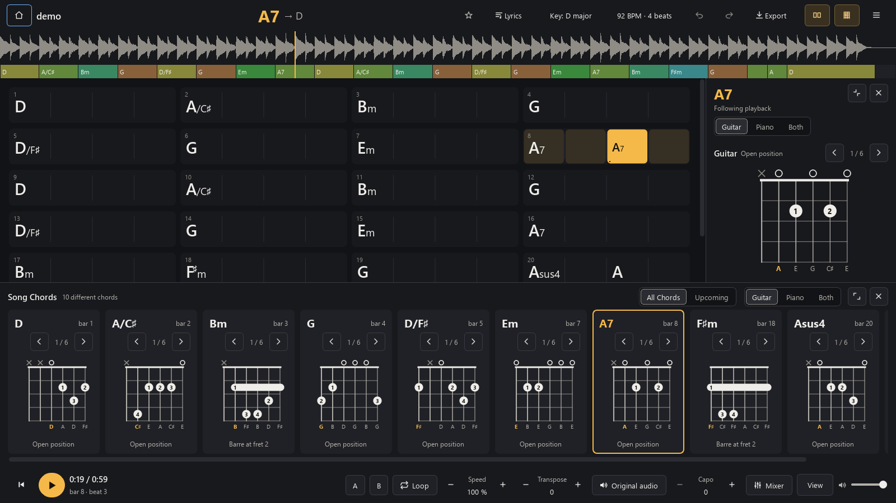

  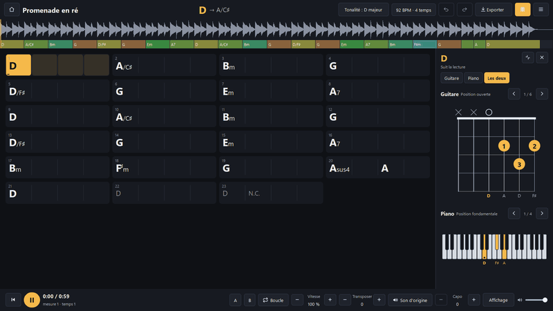

The screenshots come from the program itself, on a synthetic demo piece made for the occasion
(`scripts/demo_audio.py`) and lyrics written for it (`scripts/screenshot_lyrics.py`): no commercial
recording or lyrics. The library shows eight synthetic songs with invented titles and artists. The images
under `docs/images/en/` show the English interface of version 1.7; the others (animations, mixer, chord
sheet) were taken with the French interface of earlier versions and look the same apart from their labels.
The mixer screenshots show two freely licensed songs actually separated by the program: “Monkeys At
Typewriters” (Sj, made with Suno, CC0) and “Welcome to the War (It's Over)” (Geoffrey Benjamin Chew and
Timothy Ray Tarkelly, CC BY-SA 3.0).

## Features

- **My Library**: every song you have analysed on the home page, with search, favourites, collections,
  sorting and filters, and a complete backup in a single file.
- **Chord recognition** on your PC: major, minor, sevenths, sus, diminished, augmented and inversions
  (`D/F♯`), plus the key, tempo and time signature.
- **Synced grid**: the current chord lights up, the next one is announced, a click moves playback there.
- **Lyrics & Chords**: chords above the words, following playback; lyrics from your file, searched online
  (when you ask, or offered on their own if you allowed it), or transcribed by AI on your PC.
- **Guitar and piano diagrams** that follow playback, or a chord pinned with a click.
- **Practise a passage**: slow down from 50 to 150 % without changing the pitch, loop, transpose the grid
  and the audio, capo.
- **Correct** a chord with a double-click, with the analysis's other readings; everything saves itself and
  comes back without a new analysis.
- **Song Chords** below the grid: every chord of the song, without starting playback, or the upcoming ones.
- **Chord sheet as a PDF** to print, with the diagrams.
- **Export** as text, ChordPro or PDF; C D E or Do Ré Mi note names, sharps or flats.
- **Offline**, no account; an installer that needs no administrator rights, or a portable mode that keeps
  everything next to the program.
- **A window usable from 800 px wide** (1.5), next to another one or tiled.
- **Animated lyrics** (1.5.1): the sung line glides forward, and words light up one by one when the lyrics
  give each word's timing.
- **Updates** (1.5.1): a new version is announced if you allowed it, downloaded and verified when you ask,
  and installed only after you confirm.
- **Mixer** (1.6): separate a song into stems (vocals, drums, bass, other) on your PC, then turn one down
  or mute it during playback: sing without the vocals, play the bass line yourself, practise with less
  drums. The grid, lyrics and diagrams stay in sync.
- **English and French interface** (1.7): see [Language](#language).

## Language

**☰ menu → Langue / Language**: *Automatic*, *Français* or *English*. Automatic follows the Windows
display language: French on a French Windows, English otherwise. The change takes effect the next time
LocalChords starts, and the choice is kept.

- If you used LocalChords before version 1.7, it stays in French until you choose otherwise.
- Only the interface changes language. **Your data never does**: titles, artists, lyrics, tags,
  collection names and chord names stay exactly as they are. The **Do, Ré, Mi** note names are a separate
  setting (☰ menu), independent of the interface language.
- Exports (PDF, text) are written in the interface language; the chords and lyrics inside them are not
  touched.
- The installer asks for its language (English or French) and the in-app updater runs it in the language
  you use.
- The genres and tags LocalChords suggests appear translated, and library search finds them in either
  language. Your own genres and tags stay as you wrote them.

## My Library (1.4)

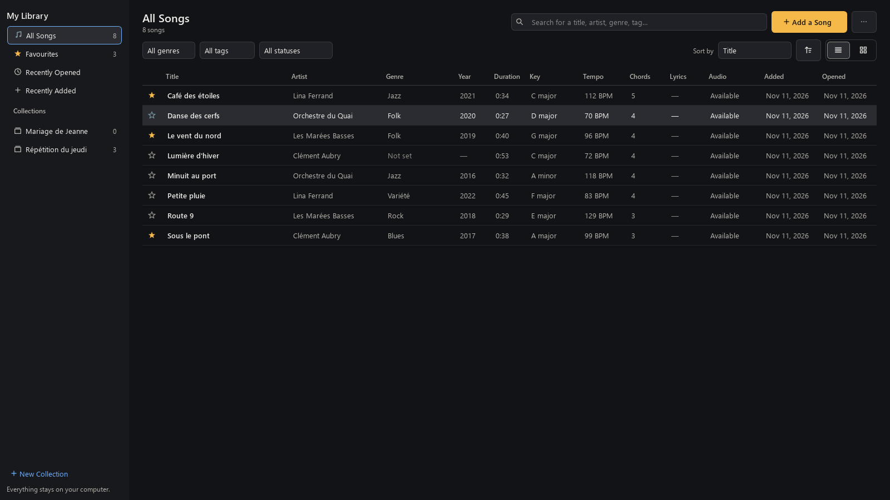

The home page is your library. Every song you analyse stays there with its details: title, artist, genre,
year, duration, key, tempo, number of chords, lyrics, audio status, date added and date last opened.
Anything unknown is shown as “—” or “Not set”, never guessed.

- **Open**: double-click or `Enter`. **Search**: `Ctrl + F`, in the title, artist, album, genre and tags,
  ignoring accents. **Filter** by genre, tag or status (with or without lyrics, audio not found, audio
  kept). **Sort** by title, artist, date added, last opened, year, genre, key or tempo (click a column, or
  “Sort by”).
- **Favourites**: the star, in the list or on the song's page. **Recently Opened** and **Recently Added**
  fill themselves.
- **Collections** (“New Collection”): add songs with a right-click or by dragging them onto the collection,
  reorder them (`Alt + ↑ ↓`), rename, delete. Deleting a collection deletes no song.
- **Genre and tags**: the genre comes from the file's tags and can be corrected; add your own tags (“To
  Learn”, “Gig”…). Several songs at once: select with `Ctrl` or `Shift`.
- **List or cards**; on a narrow screen the secondary columns hide, and on an ultrawide screen the title
  does not stretch endlessly ([5120 × 1440 screenshot](docs/images/localchords-library-5120.png), French
  interface).

  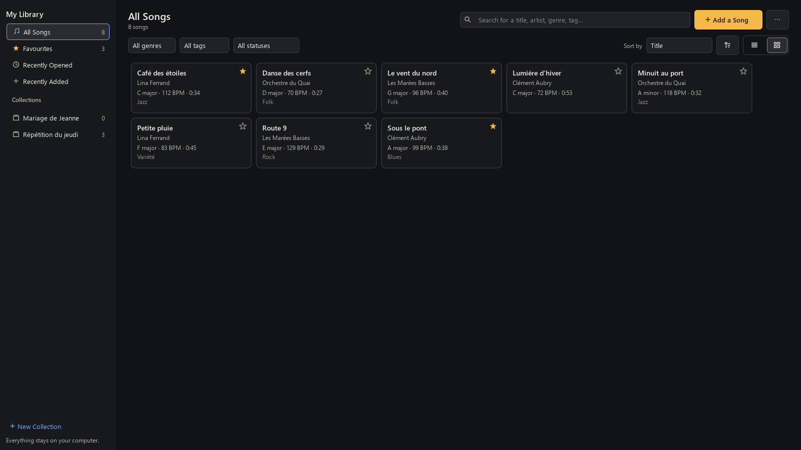

### Four things to know

| Term | What it is | Where |
|---|---|---|
| **Saved project** | a song's analysis and your corrections, saved automatically at each change | one `.lchords` file per song, in `%LOCALAPPDATA%\LocalChords\projects` |
| **Referenced audio** | the original file, where it is on your PC: LocalChords only notes its location | your music folder, untouched |
| **Kept audio** | a copy LocalChords keeps, if you ask (right-click → Audio File → “Keep a Copy in the Library”, size shown first): the song plays even if the original is moved or on an unplugged drive | `%LOCALAPPDATA%\LocalChords\audio` |
| **Library backup** | a single zip file to keep elsewhere: projects, corrections, favourites, collections, tags and preferences, and the audio if you want (size estimated first) | wherever you choose (☰ menu → “Back Up Library…”) |

**Restore** (☰ menu → “Restore a Backup…”) first shows what will change: a song already present is not
duplicated, nothing is overwritten without your consent, and the version not kept is set aside. Lyrics from
LRCLIB only go into a backup if you ask: they belong to their authors, so keep that backup to yourself.
Restoring a backup never changes the interface language.

**A file moved?** Right-click → Audio File → “Search a Folder…”, or ☰ menu → “Find Missing Audio Files…”:
only the folder you choose (and its subfolders) is examined, and a file is accepted only if it really is the
same recording. An unplugged drive shows “Drive missing” and nothing is deleted.

**Deleting, without nasty surprises.** Remove from a collection, remove from favourites, remove from the
library (the project stays; “Removed”, on the left, brings it back), delete the analysis, delete the kept
copy: each action is separate and asks for confirmation, and what is deleted goes to the Recycle Bin.
**The original audio file is never deleted.**

**Analyses from before 1.4** appear on their own at the first launch, without a new analysis and without
your `.lchords` files being changed. Their dates added and opened are not known: they are shown as
approximate (“≈”).

## Lyrics & Chords

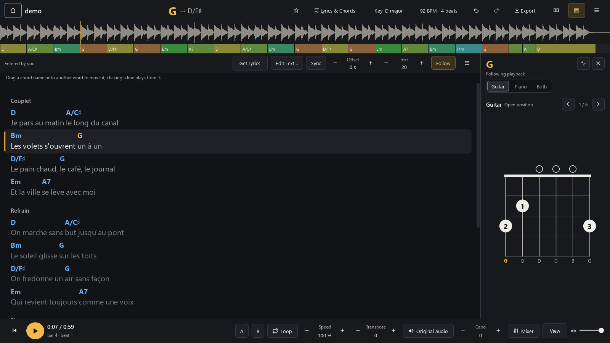

The song's lyrics, with each chord placed on the word where it falls, as in a songbook. The current line
lights up and the page scrolls by itself during playback.

- **Where the lyrics come from**, in this order:
  1. **Your computer**: a `.lrc`, `.srt` or `.txt` file with the same name next to the song, or lyrics
     written in its tags. Nothing is searched elsewhere.
  2. **Online, in the free LRCLIB database**: **Get Lyrics → Search Online (LRCLIB)**, or offered on their
     own if you allowed it (see below). Only the title, artist, album and duration are sent, never the
     audio. These lyrics are shown but cannot be exported: they belong to their authors.
  3. **Transcribed by AI, on this computer** (whisper.cpp, included with the program). The model is
     downloaded once, when you ask: 190 MB (recommended) or 574 MB (more accurate, slower). The result is
     a draft to check.
  4. Or **typed or pasted** by hand.
- **Four views** (`K` or the **Lyrics** button): Grid Only, Grid and Lyrics, Lyrics, Lyrics & Chords. The
  guitar and piano diagrams stay alongside.
- **Correct the text and timing**: **Edit Text…**, then **Sync**: `Enter` sets the chosen line to the
  playback position. A global offset in 0.1 s steps, and clicking a line plays from it.
- **Move a chord**: drag its name onto another word. **Put All Chords Back in Place** undoes these moves.
  The lyrics and your placements are saved with the project.
- **Text size**: the `−` `+` buttons or `Ctrl` + mouse wheel.

  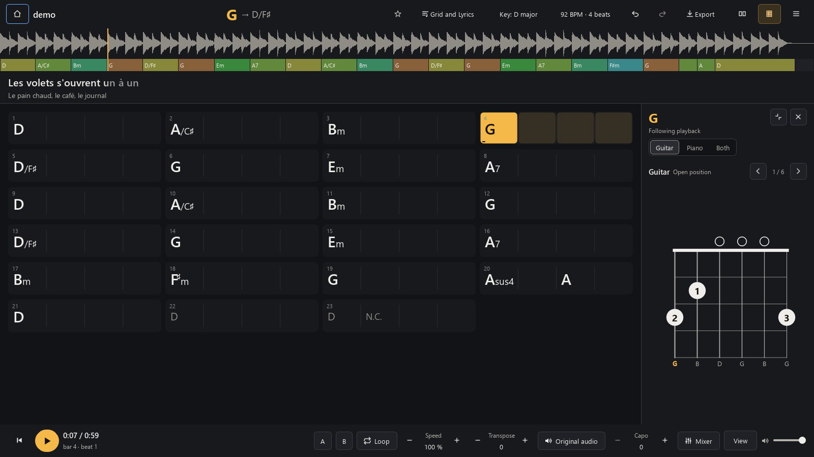

### Animated lyrics (1.5.1)

  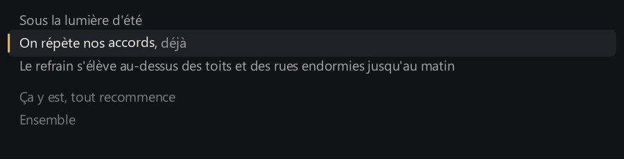

The sung line comes forward smoothly (about 0.4 s) while its neighbours fade. Chords never move and the
text does not jump: you can still drag a chord, edit the text or scroll the page yourself.

- **Words light up one by one** only when the lyrics give each word's timing: an enhanced `.lrc` file
  (`<mm:ss.xx>` before the words) or an AI transcription. With line timing only, the whole line lights up;
  lyrics without timing stay still.
- **Always in time with playback**: pause, seek, loop, speed, transposition, offset, and in all four views
  (the strip above the grid has its compact version).
- **Lyrics → ⋯ → Lyrics Animation**: **Animated** (the default), **Simple** (the highlighted line, as in
  1.5) or **Off** (no animated scrolling). The choice is kept. If Windows is set to reduce animations,
  LocalChords starts in **Simple**.
- At most 30 frames per second, and only the sung line is redrawn.

### Lyrics found for you (1.3.1)

- **The song is identified by what it says about itself**: for a link, the site's music information (title,
  artist, album), otherwise the cleaned-up video title (“Artist - Title (Official Video)” gives the artist
  and title); for a file, its tags, then its name. The channel name is never taken for the artist, and
  anything still guessed is presented as such.
- **A discreet line above the grid** (Grid and Lyrics view) when a song has no lyrics: **Search for Lyrics ·
  Transcribe with AI · Import**. The grid keeps its place; the cross hides the line for that song, and it
  disappears as soon as there are lyrics.
- **Automatic search, if you accept**: the first time, LocalChords asks whether it may search on its own for
  the lyrics of songs that have none. Your answer is kept; change it in **Menu → Search for Song Lyrics
  Automatically**. The search runs in the background, blocks nothing, and sends only the title, artist,
  album and duration.
- **The right result, or a choice**: when one version clearly matches (title, artist, duration…), **Lyrics
  found — Use · See Other Versions**; when several are equally likely, a short list to choose from; when
  nothing is reliable, nothing is offered rather than another song's lyrics. Nothing ever replaces lyrics
  already there. **Edit Search** lets you correct the title or artist, and the correction is kept.
- **Live or cover**: the catalogue's timestamps, made for the studio version, are not used; only the text
  is. **Remove Timestamps (Keep Text)**, in the ☰ menu of the Lyrics view, removes them from a version
  already taken.
- **A song of your own** (generated, unreleased): no name is invented; the line offers transcription on
  your PC, never started without you.

**Export → Lyrics & Chords (PDF)**: an A4 sheet with the chords above the words and, if you like, the
diagrams at the top or in an appendix. Also as text (lyrics only, or grid with lyrics) and as a synced
`.lrc`. Export exists only for lyrics you have the right to copy: your own, those from a file or the tags,
or a transcription; never those found online.

## Guitar and piano

  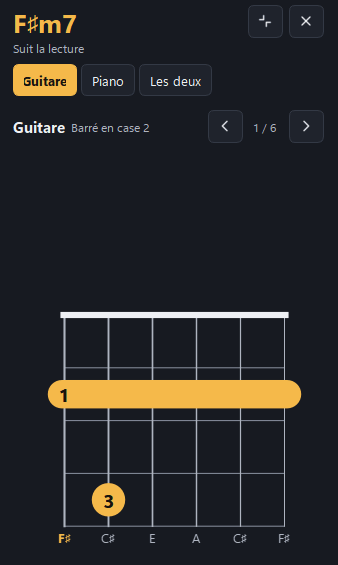
  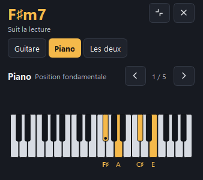

- **Guitar**: strings, frets, fingers 1 to 4, open (O) and muted (X) strings, barres, and several voicings
  to browse with `‹ ›`, the classic open shapes first (B minor: x24432).
- **Piano**: the chord's keys in colour with their names, root position and inversions; the bass of an
  inverted chord is always the lowest note. A left hand / right hand split is suggested as a guide.
- **Capo**: the diagram shows the shape to play and the panel recalls the sounding chord.
- The diagrams follow transposition, corrections and note names. Every voicing is **checked by its
  notes**: nothing is drawn because it “looks right”, and the panel says when no playable voicing exists.
- Three modes (Guitar, Piano, Both), panel full, shrunk or hidden (`D`). To the right of the grid on a wide
  screen, below it in a narrow window.

Standard tuning only.

## Song Chords

Below the grid, the **Song Chords** section shows each chord once, in order of appearance, with its bar and
diagram. No need to start playback: open a song and work through the voicings one by one before playing
along with the recording.

- **All Chords**: the complete list, with their count. An inverted chord (C/E) is counted separately.
- **Upcoming**: the current chord and the next ones, moving along with playback.
- Guitar, piano or both. The voicing chosen with `‹ ›` is the same in the section, in the panel and on the
  printed sheet, and it is saved with the project.
- Clicking a card shows the chord in the panel without moving playback; the arrow keys go from card to card.
- Section shrunk, enlarged or hidden (`T`); the app remembers. It follows transposition, capo, corrections
  and note names.

### Chord sheet (PDF)

**Export → Chord Sheet (PDF)**: an A4 sheet with the title, key, tempo and time signature, then each chord
with its diagrams (guitar, piano or both), and the grid on a separate page if you like. No diagram is split
across two pages, and the sheet shows exactly the voicings, transposition and capo shown in the program.
With the English interface, the sheet's headings are in English.

## Mixer: separate the instruments (1.6)

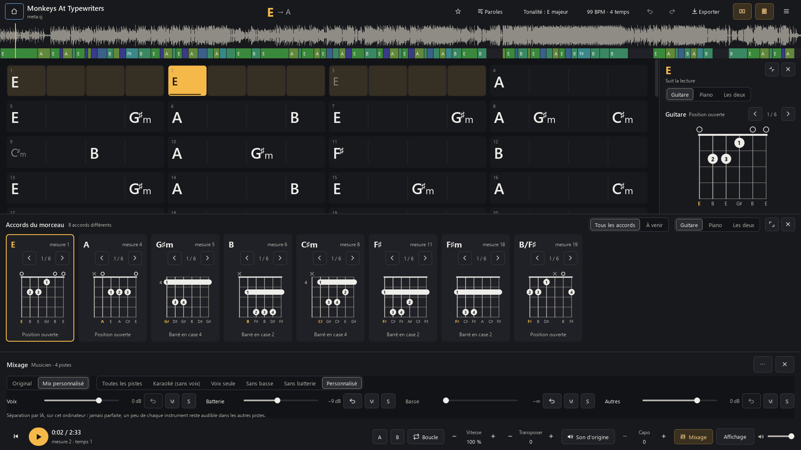

The **Mixer** button in the bottom bar (or `M`) opens the panel. Nothing is separated until you ask:

1. Choose **Karaoke** (vocals and instrumental) or **Musician** (vocals, drums, bass, other), then
   **Separate Stems**. The first time, the separation model (174 MB, Demucs v4 by Meta, MIT licence) is
   downloaded once and verified. The panel shows the space needed and, from the second separation, the
   estimated time on your PC.
2. Separation runs **on your PC**, in the background: about a fifth of the song's length on a recent
   8-core processor, more on a modest machine, and up to 3 GB of memory. You can listen, read the grid and
   switch songs in the meantime; **Cancel** stops everything.
3. Set each stem: **slider** (all the way left: complete silence), **↶** next to the level to reset that
   stem alone to 0 dB (or double-click the slider), **M** to mute it, **S** to hear it alone (the others'
   settings are kept). **Original / Custom Mix** (or `Shift + M`) compares with one click, without
   clicks or pops. Presets: *All Stems* (all at 0 dB, no M or S), *Karaoke (No Vocals)*, *Vocals Only*,
   *No Bass*, *No Drums*, and *Custom* to go back to your own setting. *Original* is the recording as it
   is; *All Stems* is the sum of the separated stems, nearly identical but not quite.

The stems are kept: reopen the song and the mix comes back as you left it, without a new separation. Speed,
transposition, loops and master volume apply to the mix. The panel's **⋯** menu exports the mix (FLAC or
WAV, lossless), separates in the other mode, deletes this song's stems, or shows the space taken by all the
stems and the model (☰ menu → *Separated Stems and Separation Model…*). Deleting stems never touches the
song, its chords or your lyrics.

**No separation is perfect**: a little of each instrument stays audible in the other stems (vocal reverb,
hi-hat in the vocals…). Guitar, piano and keyboards stay together in “Other”. Measurements, model choice
and limits: [docs/SEPARATION.md](docs/SEPARATION.md) (in French).

## Install

On the [latest release](https://github.com/tadikwa/LocalChords/releases/latest) page, under “Assets”, take
**one of the three** files:

| File | For whom | How |
|---|---|---|
| `LocalChords-Setup-v1.7.exe` (about 225 MB) | **recommended** | Double-click and follow the wizard (English or French). For your account, no administrator rights; Start menu, uninstall from Settings → Apps ([details](docs/INSTALLATEUR.md), in French). |
| `LocalChords-v1.7-portable.exe` (about 300 MB) | no installation | Download it, double-click. A single file, to keep wherever you like. |
| `LocalChords-v1.7-windows-x64.zip` (about 300 MB) | no installation, fast start | Right-click the zip → “Extract All”, then open the `LocalChords` folder and run `LocalChords.exe`. |

Same program, same results. **Your data stays put**: whichever file you choose, your songs, library and
backups stay in `%LOCALAPPDATA%\LocalChords`. Installing, updating or uninstalling never changes or deletes
them.

The installed program and the folder start in under a second. The single executable unpacks itself at each
launch: about 4 s, and 605 MB in the Windows temporary folder, cleared on exit. Nothing else to install:
no Python, no particular graphics card, no Internet connection (except to import a link, search for lyrics,
download a transcription or separation model, or check for an update if you allowed it).

**At the first launch**, Windows SmartScreen may show “Windows protected your PC”: the program is not
signed. Click “More info”, then “Run anyway”. To check the file, its SHA-256 hash is in `SHA256SUMS.txt`
on the release page (PowerShell: `Get-FileHash .\LocalChords-Setup-v1.7.exe`).

### Updates (1.5.1)

At the first launch, LocalChords asks whether it may check at startup that a new version has been
released: an anonymous request to GitHub, at most once a day, nothing about your songs. A new version is
announced in a discreet banner (**What's New**, **Download**, **Later**, **Skip This Version**). The
downloaded file is kept only if its size and SHA-256 hash are the published ones, and **nothing is
installed or launched without your confirmation**. Installer: it updates in place, your data stays put.
Single executable: the new version arrives next to the old one, which is never replaced. Zip: the archive
is verified and LocalChords explains how to set it up.

Change the choice in the **⋯** menu: **Check for Updates Automatically at Startup**; **Check for
Updates…** always works. Details and security: [docs/MISES-A-JOUR.md](docs/MISES-A-JOUR.md) (in French).

### Portable mode and uninstalling

To keep everything next to the program (USB stick), create an empty `LocalChords.portable` file next to the
single executable or the folder: see [docs/PORTABLE.md](docs/PORTABLE.md) (in French). To uninstall:
Settings → Apps for the installed version, or delete the file or folder; your analyses stay in
`%LOCALAPPDATA%\LocalChords` until you delete them yourself.

## Five steps

1. **Drag a song** into the window (MP3, WAV, FLAC, M4A, OGG, OPUS…), or “Open a Song…”.
2. **The analysis starts by itself**: allow about twenty seconds for a song. You can listen to it in the
   meantime, and “Cancel” stops everything.
3. **Space to listen.** The current chord lights up in the grid and in the diagrams.
4. **Click a chord** (or `Shift + D`) to pin it in the diagrams, `← →` move to the neighbouring beat;
   “Follow Playback” or `Esc` go back to following. **A mistake?** Double-click the chord and type the
   correction (`Am7`, `D/F#`, `Bb`, `N.C.`).
5. **It saves itself.** Reopen the song later: the grid and your corrections come back without a new
   analysis.

## Going further

### Practising a song

| What | How |
|---|---|
| Transpose | `Transpose − +` or Ctrl + ↑ ↓, up to ± 12 semitones. The button right next to it chooses whether the audio follows: “Transposed audio” (on) or “Original audio” (only the grid changes). Speed does not change. |
| Capo | `Capo − +`: the grid and diagrams show the shapes to play. |
| Diagrams | The button left of the ☰ menu, or `D`, shows or hides them. In the panel: Guitar, Piano or Both, and `‹ ›` for other voicings. |
| Slow down without changing the pitch | `Speed − +`, from 50 % to 150 %, or the `-` and `+` keys. |
| Loop a passage | Select cells (drag, or Shift + click), then `L`. Or `A` and `B` while listening. With no selection, `L` loops the current bar. |
| Simplified chords or Roman numeral analysis | `View` → Chords. |
| Sharps or flats | `View` → Accidentals. |
| Fewer spurious changes | `View` → Very short chords. |
| Correct the tempo, time signature, offset | The `92 BPM · 4 beats` button. Right-click a cell: “The First Bar Starts Here”. A `?` marks a result to check. |
| Correct the key | The `Key` button. |
| Lyrics | The `Lyrics` button or `K`: the four views. “Get Lyrics”: file, online search, transcription or typing. |
| Turn down or mute an instrument | The `Mixer` button or `M`: see [Mixer](#mixer-separate-the-instruments-16). |
| Export | `Export`: text, ChordPro or PDF; with lyrics, PDF, text or `.lrc`. |
| See what repeats | ☰ menu → Repeated Progressions. |
| Second opinion | ☰ menu → Compare with: another engine, the passages where they disagree, and you choose. |
| Import a link | Home → “Import a Link…”. |
| Do, Ré, Mi note names | ☰ menu. |
| Interface language | ☰ menu → Langue / Language. |

**Shortcuts:** F1 shows them all. Space play, ← → beat, Ctrl + ← → bar, Enter correct, Ctrl + Z undo,
`D` diagrams, `Shift + D` pin the chord, `Esc` follow playback, `K` lyrics, `M` mixer, `Shift + M`
original or mix. Shortcuts are the same in both languages.

### Importing a link

Only import what you have the right to download: that is your responsibility, and some sites' terms forbid
it. A private or restricted video is reported as such; nothing tries to get around it. YouTube changes
often: if importing stops working, a newer version of the program will be needed; for some videos,
Node.js or Deno must also be installed.

### What to know about the results

The chords are extracted automatically: **check them by ear**. Measurements and method in
[docs/BENCHMARKS.md](docs/BENCHMARKS.md) (in French). In short:

- On 20 annotated synthetic songs (Tiny AAM), 95.8 % of the time with correct triads, 92.1 % with sevenths.
  On 180 real guitar takes (GuitarSet), 90.2 % and 84.8 %.
- Neither is a **commercial recording**: no measurement has been made on that kind of music, for lack of
  free annotations. Expect worse, especially with prominent vocals. No equivalence with Chordify is
  claimed: the comparison has not been made.
- **Chords recognised:** major, minor, 7, maj7, m7, m7♭5, °7, °, +, sus2, sus4, 7sus4, and inversions
  (`C/E`) from the bass. The engine does **not** produce 9, 11, 13, 6 or add9: they are reduced to the
  nearest chord (`C9` becomes `C7`). When correcting by hand, m6, add9 and madd9 are available.
- **Time signature:** detected among 3, 4, 5, 6 and 7 beats. Checked on 4 beats only; the others have no
  evaluation on real music. The time signature button lets you correct it.
- The tempo is followed if it varies. A very free song (rubato) stays approximate.
- **Transcribed lyrics:** a draft. On 12 freely licensed songs (French and English), the recommended model
  gets about one word in three wrong, more with vocals buried in the music; line starts fall within a
  second 9 times out of 10. Read the text and re-time the lines before relying on them.

### Privacy

- The audio never leaves your PC: analysis, transcription and separation all run locally.
- Network requests happen only when you import a link, search for lyrics (title, artist, album and
  duration only, to LRCLIB), download a model (Hugging Face for transcription, GitHub for separation,
  each verified by SHA-256), or check for updates (an anonymous request to GitHub, if you allowed it).
- No account, no telemetry, no advertising.

### AI engines

| Task | Engine | Where it runs |
|---|---|---|
| Chords | lv-chordia (neural) or a classic chroma engine for a second opinion | your PC |
| Beats and bars | Beat This! | your PC |
| Lyrics transcription | whisper.cpp (OpenAI Whisper models, downloaded once) | your PC |
| Stem separation | Demucs v4 “htdemucs” (Meta, MIT licence), ONNX | your PC |

### Known limits

- Standard guitar tuning only; no 9, 11, 13, 6 or add9 chords from the analysis.
- Time signatures other than 4 beats are detected but not evaluated on real music.
- No separation is perfect, and guitar, piano and keyboards share the “Other” stem.
- Transcribed lyrics are a draft to check.
- The interface is in English and French only; changing the language takes effect at the next start.
- Some technical documents in `docs/` are in French only.

### If something goes wrong

- **“Audio output unavailable”**: check the Windows sound output, then start playback again.
- **“Not enough memory”** or a sudden stop: analysis needs about 1 GB for a song, 4 GB for 20 minutes,
  11 GB for an hour.
- **Separation impossible**: the Mixer panel says why (disk space, memory, model not downloaded) and offers
  to try again. About 3 GB of free memory is needed.
- **Another error:** the details are in `%LOCALAPPDATA%\LocalChords\log.txt` (in portable mode:
  `Data\log.txt`).

Your analysed songs are in `%LOCALAPPDATA%\LocalChords\projects`: deleting a file forgets only its analysis
and your corrections. Audio files are neither copied nor changed, except those imported from a link, kept
in `%LOCALAPPDATA%\LocalChords\downloads`. Transcription models are in
`%LOCALAPPDATA%\LocalChords\models\whisper`: delete them from the transcription window. The separation
model is in `models\separation` and the separated stems in `stems` (about 10 to 20 MB per minute of song):
delete them from the mixer. In portable mode, all of this is in the `Data` folder next to the program.

### For developers

Build: `scripts\build.ps1`. Test: `.venv\Scripts\python -m pytest`. Localisation (adding a language,
updating the catalogues): [docs/LOCALISATION.md](docs/LOCALISATION.md). Technical documentation (in
French): [docs/TECHNIQUE.md](docs/TECHNIQUE.md), design: [docs/DESIGN.md](docs/DESIGN.md), release notes:
[docs/NOTES-v1.7.md](docs/NOTES-v1.7.md). Licences: LocalChords is under the MIT licence
([LICENSE](LICENSE)); third-party components in [LICENCES-TIERS.md](LICENCES-TIERS.md).
