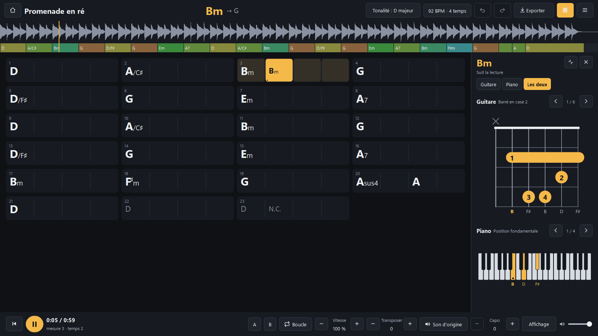
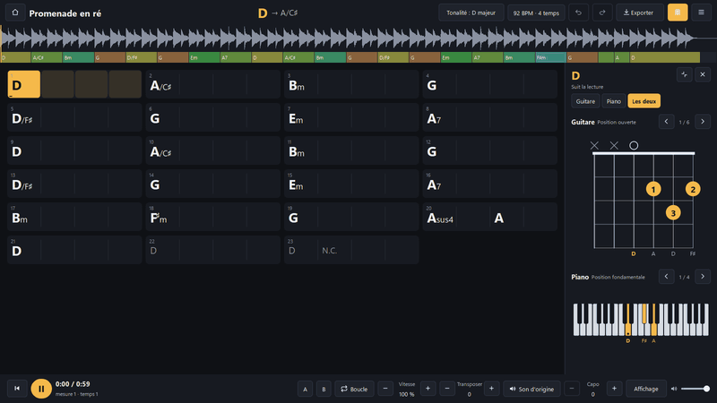
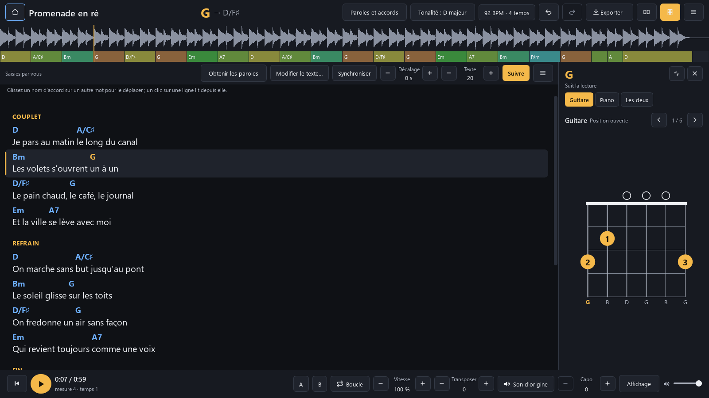
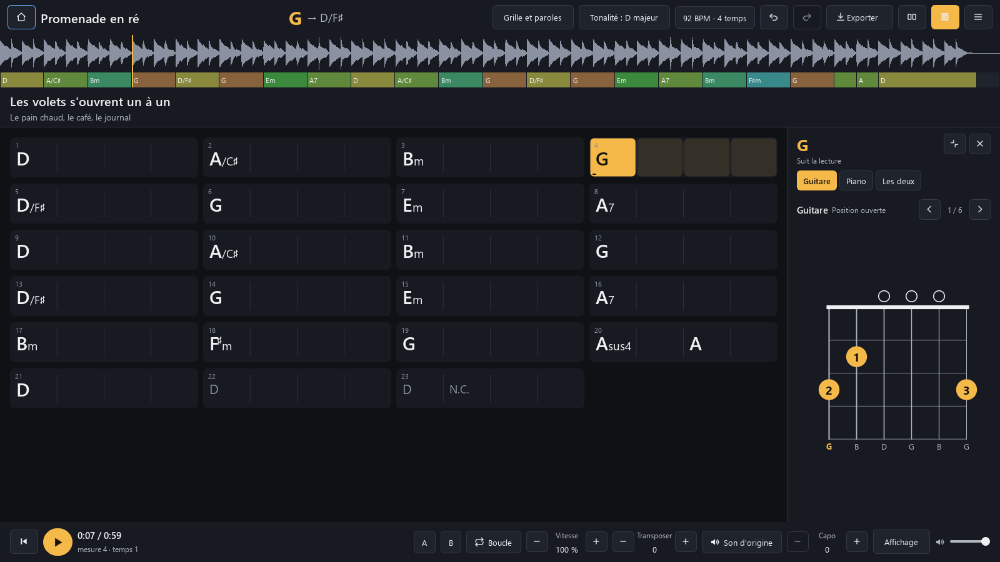
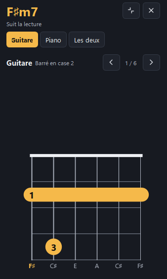
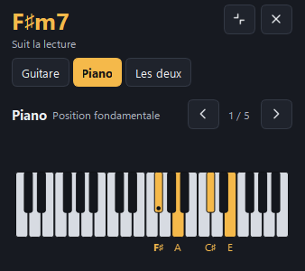
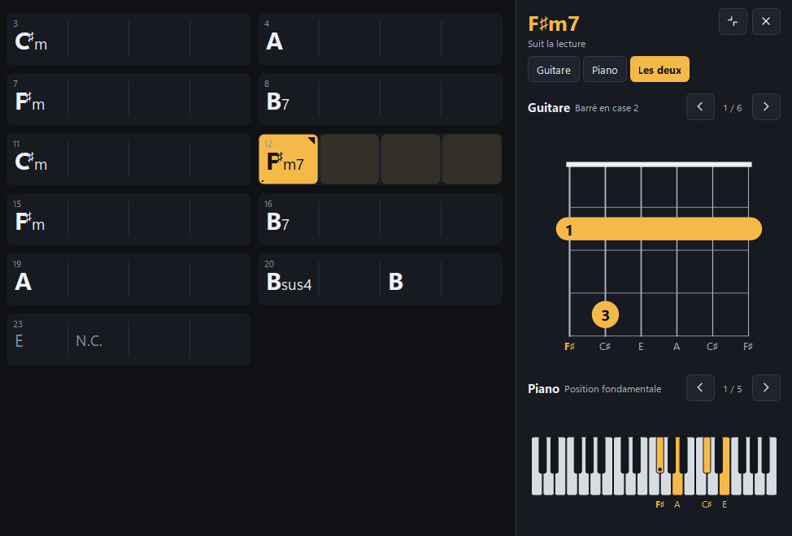
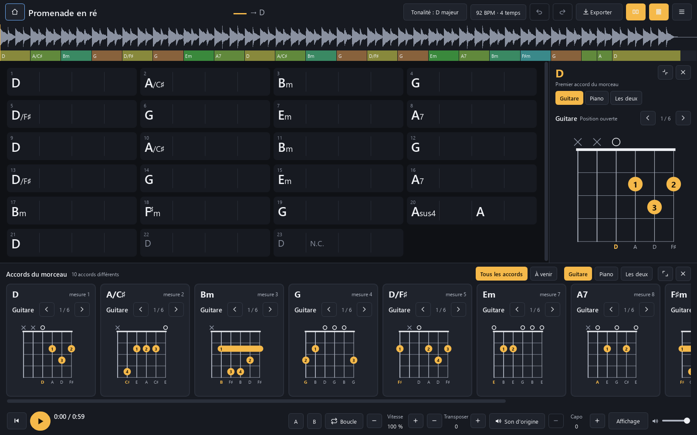
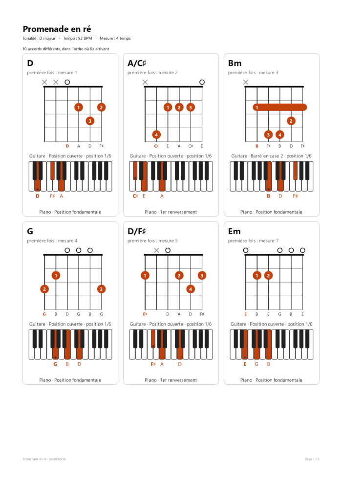

# LocalChords

Une grille d'accords lisible et synchronisée avec la lecture, sur votre PC Windows, avec les diagrammes de
guitare et de piano de l'accord joué. Vous déposez un morceau, les accords apparaissent par mesures et
défilent pendant l'écoute. Tout se passe sur votre ordinateur : l'audio n'est envoyé nulle part, aucun compte,
aucun abonnement.

**[⬇ Télécharger la dernière version](https://github.com/tadikwa/LocalChords/releases/latest)** (Windows 10
ou 11, 64 bits, gratuit, hors ligne)

  

Les captures viennent du programme (celles des accords du morceau et de la fiche : version 1.2.1, celles des
paroles : version 1.3, lancées depuis les sources, rendu hors écran), sur un morceau de démonstration
synthétique créé pour l'occasion (`scripts/demo_audio.py`) et des paroles écrites pour lui
(`scripts/screenshot_lyrics.py`) : aucun enregistrement ni aucune parole du commerce.

## Fonctionnalités

- **Reconnaissance des accords** sur votre PC : majeurs, mineurs, septièmes, sus, diminués, augmentés et
  renversements (`D/F♯`), avec la tonalité, le tempo et la mesure.
- **Grille synchronisée** : l'accord en cours s'allume, le suivant est annoncé, un clic place la lecture.
- **Paroles et accords** : les accords au-dessus des mots, qui suivent la lecture ; paroles de votre
  fichier, cherchées en ligne à votre demande, ou transcrites par l'IA sur votre PC.
- **Diagrammes de guitare et de piano** qui suivent la lecture, ou un accord épinglé d'un clic.
- **Travailler un passage** : ralentir de 50 à 150 % sans changer la hauteur, boucler, transposer la grille et
  le son, capodastre.
- **Corriger** un accord d'un double-clic, avec les autres lectures de l'analyse ; tout est enregistré seul et
  revient sans nouvelle analyse.
- **Tous les accords du morceau** sous la grille, sans lancer la lecture, ou ceux qui arrivent.
- **Fiche des accords en PDF** à imprimer, avec les diagrammes.
- **Exporter** en texte, ChordPro ou PDF ; notation C D E ou Do ré mi, dièses ou bémols.
- **Hors ligne**, sans compte ; un mode portable garde tout à côté du programme.

## Paroles et accords

Nouveau en 1.3 : les paroles du morceau, avec chaque accord posé sur le mot où il tombe, comme sur une
partition de chanson. La ligne en cours s'allume et la page défile seule pendant la lecture.

- **D'où viennent les paroles**, dans cet ordre :
  1. **Votre ordinateur** : un fichier `.lrc`, `.srt` ou `.txt` du même nom à côté du morceau, ou les paroles
     écrites dans ses étiquettes. Rien n'est cherché ailleurs.
  2. **En ligne, à votre demande** : **Obtenir les paroles → Chercher en ligne (LRCLIB)**. Seuls le titre,
     l'artiste, l'album et la durée sont envoyés, jamais l'audio. Ces paroles s'affichent mais ne s'exportent
     pas : elles appartiennent à leurs auteurs.
  3. **Transcrites par l'IA, sur cet ordinateur** (whisper.cpp, livré avec le programme). Le modèle se
     télécharge une fois, à votre demande : 190 Mo (conseillé) ou 574 Mo (plus précis, plus lent). Le
     résultat est un brouillon à relire.
  4. Ou **saisies et collées** à la main.
- **Quatre vues** (`K` ou le bouton **Paroles**) : Grille seule, Grille et paroles, Paroles, Paroles et
  accords. Les diagrammes de guitare et de piano restent à côté.
- **Corriger le texte et le temps** : **Modifier le texte…**, puis **Synchroniser** : `Entrée` cale la ligne
  choisie sur la lecture. Un décalage global de 0,1 s en 0,1 s, et un clic sur une ligne lit depuis elle.
- **Déplacer un accord** : glissez son nom sur un autre mot. **Remettre tous les accords à leur place**
  annule ces déplacements. Les paroles et vos placements sont enregistrés avec le projet.
- **Taille du texte** : boutons `−` `+` ou `Ctrl` + molette.

  

**Exporter → Paroles et accords (PDF)** : une fiche A4 avec les accords au-dessus des mots et, au choix, les
diagrammes en tête ou en annexe. Aussi en texte (paroles seules, ou grille avec paroles) et en
`.lrc` synchronisé. L'export n'existe
que pour les paroles que vous avez le droit de copier : les vôtres, celles d'un fichier ou des étiquettes, ou
une transcription ; jamais celles trouvées en ligne.

## Guitare et piano

  
  

- **Guitare** : cordes, cases, doigts 1 à 4, cordes à vide (O) et étouffées (X), barrés, et plusieurs
  positions à parcourir avec `‹ ›`, les formes ouvertes classiques en premier (Si mineur : x24432).
- **Piano** : les touches de l'accord en couleur avec leurs noms, la position fondamentale et les
  renversements ; la basse d'un accord renversé est toujours la plus grave. Une répartition main gauche /
  main droite est proposée à titre indicatif.
- **Capo** : le diagramme montre la forme à jouer et le panneau rappelle le son réel.
- Les diagrammes suivent la transposition, les corrections et la notation. Chaque position est **vérifiée par
  ses notes** : rien n'est dessiné parce qu'il « a l'air juste », et le panneau dit quand aucune position
  jouable n'existe.
- Trois modes (Guitare, Piano, Les deux), panneau complet, réduit ou masqué (`D`). À droite de la grille sur
  un écran large, dessous sur une fenêtre étroite.

Accordage standard uniquement.

## Tous les accords du morceau

Sous la grille, la section **Accords du morceau** montre chaque accord une seule fois, dans l'ordre où il
arrive, avec sa mesure et son diagramme. Pas besoin de lancer la lecture : ouvrez un morceau et travaillez
les positions une par une, avant de jouer avec l'enregistrement.

- **Tous les accords** : la liste complète, avec leur nombre. Un accord renversé (C/E) est compté à part.
- **À venir** : l'accord en cours et les suivants, qui défilent avec la lecture.
- Guitare, piano ou les deux. La position choisie avec `‹ ›` est la même dans la section, dans le panneau et
  sur la fiche imprimée, et elle est enregistrée avec le projet.
- Un clic sur une carte affiche l'accord dans le panneau sans déplacer la lecture ; les flèches passent d'une
  carte à l'autre.
- Section réduite, agrandie ou masquée (`T`) ; l'application s'en souvient. Elle suit la transposition, le
  capo, les corrections et la notation.

### Fiche des accords (PDF)

  

**Exporter → Fiche des accords (PDF)** : une fiche A4 avec le titre, la tonalité, le tempo, la mesure, puis
chaque accord avec ses diagrammes (guitare, piano ou les deux), et la grille en option sur une page à part.
Aucun diagramme n'est coupé entre deux pages, et la fiche reprend exactement les positions, la transposition
et le capo affichés dans le programme.

## Installer

Sur la page de la [dernière version](https://github.com/tadikwa/LocalChords/releases/latest), dans « Assets »,
prenez **l'un des deux** fichiers :

| Fichier | Pour qui | Comment |
|---|---|---|
| `LocalChords-v1.2.1-portable.exe` (environ 285 Mo) | le plus simple | Téléchargez-le, double-cliquez. Un seul fichier, à garder où vous voulez. |
| `LocalChords-v1.2.1-windows-x64.zip` (environ 285 Mo) | un usage quotidien | Clic droit sur le zip → « Extraire tout », puis ouvrez le dossier `LocalChords` et lancez `LocalChords.exe`. |

Même programme, mêmes résultats. Le dossier démarre en moins d'une seconde. L'exécutable unique se
décompresse à chaque lancement : environ 3,5 s, et 570 Mo dans le dossier temporaire de Windows, effacés
à la fermeture. Rien d'autre à installer : ni Python, ni carte graphique particulière, ni connexion Internet
(sauf pour importer un lien, chercher des paroles ou télécharger un modèle de transcription).

**Au premier lancement**, Windows SmartScreen peut afficher « Windows a protégé votre ordinateur » : le
programme n'est pas signé. Cliquez sur « Informations complémentaires », puis « Exécuter quand même ».
Pour vérifier le fichier, son empreinte SHA-256 figure dans `SHA256SUMS.txt` sur la page de la version
(PowerShell : `Get-FileHash .\LocalChords-v1.3-portable.exe`).

Pour tout garder à côté du programme (clé USB), créez un fichier vide `LocalChords.portable` à côté de
l'exécutable : voir [docs/PORTABLE.md](docs/PORTABLE.md). Pour désinstaller, supprimez le fichier ou le
dossier ; vos analyses restent dans `%LOCALAPPDATA%\LocalChords` tant que vous ne les effacez pas.

## Utiliser en 5 étapes

1. **Glissez un morceau** dans la fenêtre (MP3, WAV, FLAC, M4A, OGG, OPUS…), ou « Ouvrir un morceau ».
2. **L'analyse démarre seule** : comptez une vingtaine de secondes pour une chanson. Le morceau reste
   écoutable pendant ce temps, et « Annuler » arrête tout.
3. **Espace pour écouter.** L'accord en cours s'allume dans la grille et dans les diagrammes.
4. **Un clic sur un accord** (ou `Maj + D`) l'épingle dans les diagrammes, `← →` passent au temps voisin ;
   « Suivre la lecture » ou `Échap` reprennent le suivi. **Une erreur ?** Double-cliquez sur l'accord et tapez la correction (`Am7`, `D/F#`, `Sib`, `N.C.`).
5. **C'est enregistré tout seul.** Rouvrez le morceau plus tard : la grille et vos corrections reviennent
   sans nouvelle analyse.

## Pour aller plus loin

### Travailler un morceau

| Quoi | Comment |
|---|---|
| Transposer | `Transposer − +` ou Ctrl + ↑ ↓, jusqu'à ± 12 demi-tons. Le bouton juste à côté choisit si le son suit : « Son transposé » (allumé) ou « Son d'origine » (seule la grille change). La vitesse ne change pas. |
| Capodastre | `Capo − +` : la grille et les diagrammes montrent les formes à jouer. |
| Diagrammes | Le bouton à gauche du menu ☰, ou `D`, les montre ou les masque. Dans le panneau : Guitare, Piano ou Les deux, et `‹ ›` pour les autres positions. |
| Ralentir sans changer la hauteur | `Vitesse − +`, de 50 % à 150 %, ou les touches `-` et `+`. |
| Boucler un passage | Sélectionnez des cases (glisser, ou Maj + clic), puis `L`. Ou `A` et `B` pendant l'écoute. Sans sélection, `L` boucle la mesure en cours. |
| Accords simplifiés ou analyse des degrés | `Affichage` → Accords. |
| Dièses ou bémols | `Affichage` → Altérations. |
| Moins de changements parasites | `Affichage` → Accords très courts. |
| Corriger le tempo, la mesure, le décalage | Le bouton `92 BPM · 4 temps`. Clic droit sur une case : « La première mesure commence ici ». Un `?` signale un résultat à vérifier. |
| Corriger la tonalité | Le bouton `Tonalité`. |
| Paroles | Le bouton `Paroles` ou `K` : les quatre vues. « Obtenir les paroles » : fichier, recherche en ligne, transcription ou saisie. |
| Exporter | `Exporter` : texte, ChordPro ou PDF ; avec les paroles, PDF, texte ou `.lrc`. |
| Voir ce qui revient | Menu ☰ → Progressions répétées. |
| Deuxième avis | Menu ☰ → Comparer avec : un autre moteur, les passages en désaccord, et vous choisissez. |
| Importer un lien | Accueil → « Importer un lien ». |
| Notes en Do, Ré, Mi | Menu ☰. |

**Raccourcis :** F1 les affiche tous. Espace lecture, ← → temps, Ctrl + ← → mesure, Entrée corriger,
Ctrl + Z annuler, `D` diagrammes, `Maj + D` épingler l'accord, `Échap` suivre la lecture, `K` paroles.

### Importer un lien

N'importez que ce que vous avez le droit de télécharger : c'est de votre responsabilité, et les
conditions de certains sites l'interdisent. Une vidéo privée ou restreinte est signalée comme telle,
rien ne cherche à le contourner. YouTube change souvent : si l'import cesse de marcher, il faudra une
version plus récente du programme ; pour certaines vidéos, Node.js ou Deno doit aussi être installé.

### Ce qu'il faut savoir sur les résultats

Les accords sont extraits automatiquement : **vérifiez à l'oreille**. Mesures effectives et méthode dans
[docs/BENCHMARKS.md](docs/BENCHMARKS.md). En bref :

- Sur 20 morceaux artificiels annotés (Tiny AAM), 95,8 % du temps en bonnes triades, 92,1 % avec les
  septièmes. Sur 180 prises réelles de guitare (GuitarSet), 90,2 % et 84,8 %.
- Ni l'un ni l'autre n'est un **morceau du commerce** : aucune mesure n'a été faite sur ce type de musique,
  faute d'annotations libres. Attendez-vous à moins bien, surtout avec une voix très présente. Aucune
  équivalence avec Chordify n'est revendiquée : la comparaison n'a pas été faite.
- **Accords reconnus :** majeur, mineur, 7, maj7, m7, m7♭5, °7, °, +, sus2, sus4, 7sus4, et les renversements
  (`C/E`) par la basse. Le moteur ne produit **pas** de 9, 11, 13, 6 ni add9 : ils sont ramenés à
  l'accord le plus proche (`C9` devient `C7`). En correction manuelle, m6, add9 et madd9 sont disponibles.
- **Mesure :** détectée parmi 3, 4, 5, 6 et 7 temps. Vérifiée sur du 4 temps uniquement ; les autres n'ont pas
  d'évaluation sur musique réelle. Le bouton de mesure permet de corriger.
- Le tempo est suivi s'il varie. Un morceau très libre (rubato) reste approximatif.
- **Paroles transcrites :** un brouillon. Sur 12 chansons sous licence libre (français et anglais), le
  modèle conseillé se trompe sur environ un mot sur trois, plus avec une voix noyée dans la musique ; les
  débuts de ligne tombent à moins d'une seconde près de 9 fois sur 10. Relisez le texte et recalez les lignes avant
  de vous y fier : mesures dans [docs/BENCHMARKS.md](docs/BENCHMARKS.md).

### Si ça ne marche pas

- **« Sortie audio indisponible »** : vérifiez la sortie son de Windows, puis relancez la lecture.
- **« Mémoire insuffisante »** ou arrêt brutal : l'analyse demande environ 1 Go pour une chanson, 4 Go pour 20 minutes,
  11 Go pour une heure.
- **Autre erreur :** le détail est dans `%LOCALAPPDATA%\LocalChords\log.txt` (en mode portable : `Data\log.txt`).

Vos morceaux analysés sont dans `%LOCALAPPDATA%\LocalChords\projects` : effacer un fichier n'oublie que
son analyse et vos corrections. Les fichiers audio ne sont ni copiés ni modifiés, sauf ceux importés
par lien, gardés dans `%LOCALAPPDATA%\LocalChords\downloads`. Les modèles de transcription sont dans
`%LOCALAPPDATA%\LocalChords\models\whisper` : on les supprime depuis la fenêtre de transcription. En mode portable, tout cela est dans le dossier
`Data` à côté du programme.

### Pour les développeurs

Construire : `scripts\build.ps1`. Tester : `.venv\Scripts\python -m pytest`. Documentation technique :
[docs/TECHNIQUE.md](docs/TECHNIQUE.md), notes de version : [docs/NOTES-v1.3.md](docs/NOTES-v1.3.md), [docs/NOTES-v1.2.1.md](docs/NOTES-v1.2.1.md) et [docs/NOTES-v1.2.md](docs/NOTES-v1.2.md).
Licences : LocalChords est sous licence MIT ([LICENSE](LICENSE)) ; composants tiers dans
[LICENCES-TIERS.md](LICENCES-TIERS.md).
