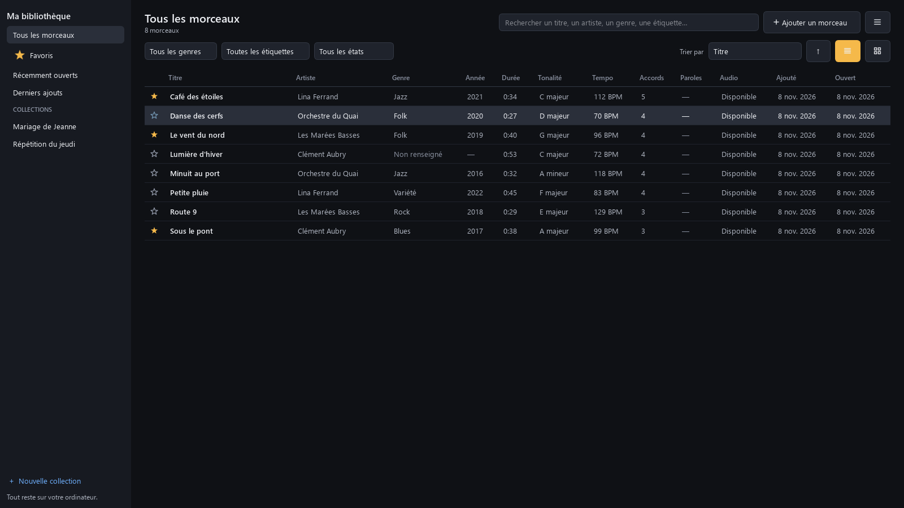
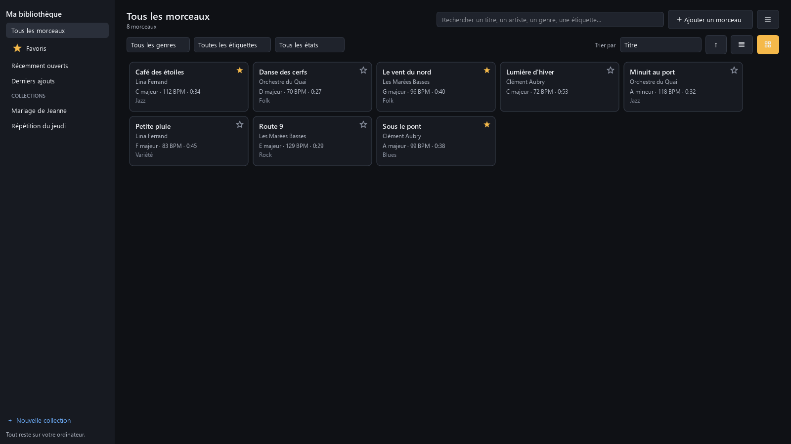
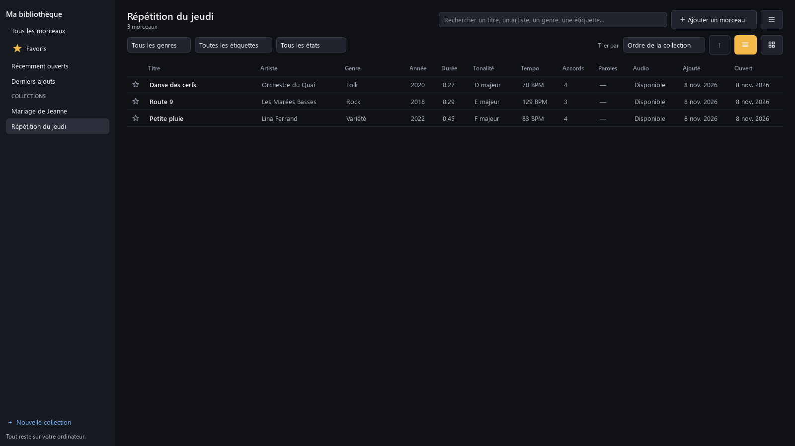
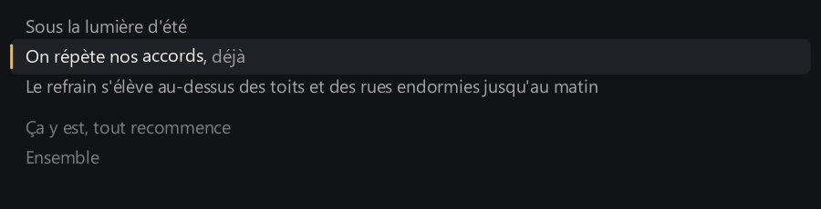
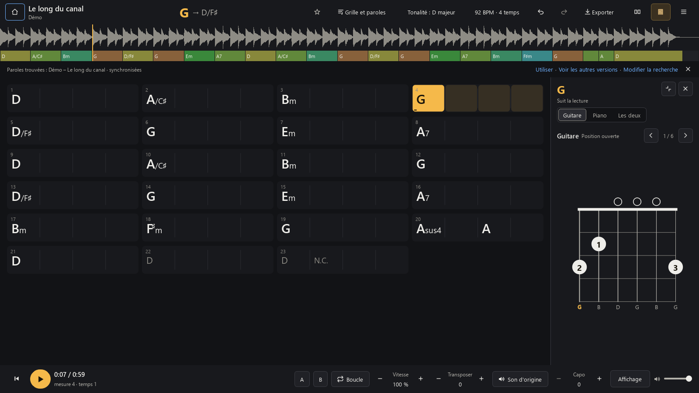
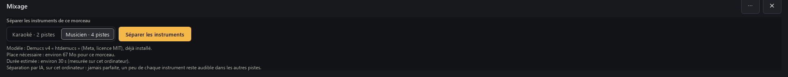
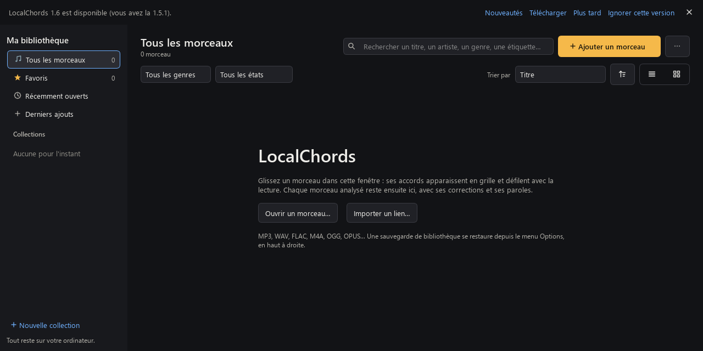

# LocalChords

Une grille d'accords lisible et synchronisée avec la lecture, sur votre PC Windows, avec les diagrammes de
guitare et de piano de l'accord joué. Vous déposez un morceau, les accords apparaissent par mesures et
défilent pendant l'écoute. Tout se passe sur votre ordinateur : l'audio n'est envoyé nulle part, aucun compte,
aucun abonnement.

**[⬇ Télécharger la dernière version](https://github.com/tadikwa/LocalChords/releases/latest)** (Windows 10
ou 11, 64 bits, gratuit, hors ligne)

  

Les captures viennent du programme (version 1.5, lancée depuis les sources, rendu hors écran ; les paroles
animées et le bandeau de mise à jour : version 1.5.1 ; l'animation de la grille, les diagrammes seuls et la
fiche : version 1.2.1 ; le mixage : version 1.6), sur un morceau de démonstration
synthétique créé pour l'occasion (`scripts/demo_audio.py`) et des paroles écrites pour lui
(`scripts/screenshot_lyrics.py`) : aucun enregistrement ni aucune parole du commerce. Les morceaux de la
bibliothèque sont huit morceaux synthétiques aux titres et artistes inventés, analysés par le programme dans
un dossier temporaire (`scripts/library_screenshots.py`). Les captures du mixage montrent deux morceaux
libres réellement séparés par le programme : « Monkeys At Typewriters » (Sj, fait avec Suno, CC0) et
« Welcome to the War (It's Over) » (Geoffrey Benjamin Chew et Timothy Ray Tarkelly, CC BY-SA 3.0).

## Fonctionnalités

- **Ma bibliothèque** : tous vos morceaux analysés sur la page d'accueil, avec recherche, favoris,
  collections, tris et filtres, et une sauvegarde complète dans un seul fichier.
- **Reconnaissance des accords** sur votre PC : majeurs, mineurs, septièmes, sus, diminués, augmentés et
  renversements (`D/F♯`), avec la tonalité, le tempo et la mesure.
- **Grille synchronisée** : l'accord en cours s'allume, le suivant est annoncé, un clic place la lecture.
- **Paroles et accords** : les accords au-dessus des mots, qui suivent la lecture ; paroles de votre
  fichier, cherchées en ligne (à votre demande, ou proposées seules si vous l'avez permis), ou transcrites
  par l'IA sur votre PC.
- **Diagrammes de guitare et de piano** qui suivent la lecture, ou un accord épinglé d'un clic.
- **Travailler un passage** : ralentir de 50 à 150 % sans changer la hauteur, boucler, transposer la grille et
  le son, capodastre.
- **Corriger** un accord d'un double-clic, avec les autres lectures de l'analyse ; tout est enregistré seul et
  revient sans nouvelle analyse.
- **Tous les accords du morceau** sous la grille, sans lancer la lecture, ou ceux qui arrivent.
- **Fiche des accords en PDF** à imprimer, avec les diagrammes.
- **Exporter** en texte, ChordPro ou PDF ; notation C D E ou Do ré mi, dièses ou bémols.
- **Hors ligne**, sans compte ; un installateur sans droits d'administrateur, ou un mode portable qui garde
  tout à côté du programme.
- **Une fenêtre utilisable dès 800 px** de large (1.5), à côté d'une autre ou en mosaïque.
- **Paroles animées** (1.5.1) : la ligne chantée avance doucement, et les mots s'éclairent un à un quand
  les paroles donnent l'heure de chaque mot.
- **Mises à jour** (1.5.1) : une nouvelle version vous est signalée si vous l'avez permis, téléchargée et
  vérifiée à votre demande, installée seulement après votre confirmation.
- **Mixage des instruments** (1.6) : séparez un morceau en pistes (voix, batterie, basse, autres) sur votre
  PC, puis baissez ou coupez-en une pendant la lecture : chanter sans la voix, jouer la basse à la place
  de la basse, travailler avec moins de batterie. Grille, paroles et diagrammes restent synchronisés.

## Ma bibliothèque (1.4)

Nouveau en 1.4 : la page d'accueil devient votre bibliothèque. Chaque morceau analysé y reste, avec ses
informations : titre, artiste, genre, année, durée, tonalité, tempo, nombre d'accords, paroles, état de
l'audio, dates d'ajout et de dernière ouverture. Ce qui n'est pas connu s'affiche « — » ou « Non
renseigné », jamais deviné.

- **Ouvrir** : double-clic ou `Entrée`. **Chercher** : `Ctrl + F`, sur le titre, l'artiste, l'album, le
  genre et les étiquettes, sans tenir compte des accents. **Filtrer** par genre, étiquette ou état (avec
  ou sans paroles, audio introuvable, audio conservé). **Trier** par titre, artiste, date d'ajout,
  dernière ouverture, année, genre, tonalité ou tempo (clic sur une colonne, ou « Trier par »).
- **Favoris** : l'étoile, dans la liste ou sur la page du morceau. **Récemment ouverts** et **Derniers
  ajouts** se remplissent seuls.
- **Collections** (« Nouvelle collection ») : ajoutez des morceaux par le clic droit ou en les glissant sur
  la collection, remettez-les dans l'ordre (`Alt + ↑ ↓`), renommez, supprimez. Supprimer une collection ne
  supprime aucun morceau.
- **Genre et étiquettes** : le genre vient des étiquettes du fichier et se corrige ; ajoutez vos propres
  étiquettes (« à travailler », « concert »…). Plusieurs morceaux à la fois : sélection avec `Ctrl` ou `Maj`.
- **En liste ou en cartes** ; sur un écran étroit, les colonnes secondaires se cachent, et sur un écran
  ultra-large le titre ne s'étire pas sans fin ([capture en 5120 × 1440](docs/images/localchords-library-5120.png)).

  

### Les quatre notions

| Notion | Ce que c'est | Où |
|---|---|---|
| **Projet sauvegardé** | l'analyse d'un morceau et vos corrections, enregistrées seules à chaque changement | un fichier `.lchords` par morceau, dans `%LOCALAPPDATA%\LocalChords\projects` |
| **Audio référencé** | le fichier d'origine, là où il est sur votre PC : LocalChords note seulement son emplacement | votre dossier de musique, inchangé |
| **Audio conservé** | une copie que LocalChords garde, sur votre demande (clic droit → Fichier audio → « Conserver une copie dans la bibliothèque », taille annoncée) : le morceau se joue même si l'original est déplacé ou sur un disque débranché | `%LOCALAPPDATA%\LocalChords\audio` |
| **Sauvegarde de bibliothèque** | un seul fichier zip à garder ailleurs : projets, corrections, favoris, collections, étiquettes et préférences, et l'audio si vous le voulez (taille estimée avant) | où vous le choisissez (menu ☰ → « Sauvegarder la bibliothèque… ») |

**Restaurer** (menu ☰ → « Restaurer une sauvegarde… ») montre d'abord ce qui va changer : un morceau déjà
présent n'est pas dupliqué, rien n'est écrasé sans votre accord, et la version écartée est mise de côté.
Les paroles venues de LRCLIB ne partent dans une sauvegarde que si vous le demandez : elles appartiennent à
leurs auteurs, gardez cette sauvegarde pour vous.

**Un fichier déplacé ?** Clic droit → Fichier audio → « Rechercher dans un dossier… », ou menu ☰ → « Retrouver les fichiers audio manquants… » : seul le dossier que vous choisissez
(et ses sous-dossiers) est examiné, et un fichier n'est accepté que s'il s'agit bien du même
enregistrement. Un disque débranché affiche « Disque absent » et rien n'est supprimé.

**Supprimer, sans mauvaise surprise.** Retirer d'une collection, retirer des favoris, retirer de la
bibliothèque (le projet reste ; « Retirés », à gauche, le rend), supprimer l'analyse, supprimer
la copie conservée : chaque action est séparée et demande confirmation, et ce qui est supprimé va à la
Corbeille. **Le fichier audio d'origine n'est jamais supprimé.**

**Vos analyses d'avant la 1.4** apparaissent seules au premier lancement, sans nouvelle analyse et sans
que vos fichiers `.lchords` soient modifiés. Leurs dates d'ajout et d'ouverture ne sont pas connues : elles
s'affichent approchées (« ≈ »).

  

## Paroles et accords

Nouveau en 1.3 : les paroles du morceau, avec chaque accord posé sur le mot où il tombe, comme sur une
partition de chanson. La ligne en cours s'allume et la page défile seule pendant la lecture.

- **D'où viennent les paroles**, dans cet ordre :
  1. **Votre ordinateur** : un fichier `.lrc`, `.srt` ou `.txt` du même nom à côté du morceau, ou les paroles
     écrites dans ses étiquettes. Rien n'est cherché ailleurs.
  2. **En ligne, dans la base libre LRCLIB** : **Obtenir les paroles → Rechercher en ligne (LRCLIB)**, ou
     proposées seules si vous l'avez permis (voir plus bas). Seuls le titre, l'artiste, l'album et la durée
     sont envoyés, jamais l'audio. Ces paroles s'affichent mais ne s'exportent pas : elles appartiennent à
     leurs auteurs.
  3. **Transcrites par l'IA, sur cet ordinateur** (whisper.cpp, livré avec le programme). Le modèle se
     télécharge une fois, à votre demande : 190 Mo (conseillé) ou 574 Mo (plus précis, plus lent). Le
     résultat est un brouillon à relire.
  4. Ou **saisies et collées** à la main.
- **Quatre vues** (`K` ou le bouton **Paroles**) : Grille seule, Grille et paroles, Paroles, Paroles et
  accords. Les diagrammes de guitare et de piano restent à côté.
- **Corriger le texte et le temps** : **Modifier le texte…**, puis **Synchroniser** : `Entrée` cale la ligne
  choisie sur la lecture. Un décalage global de 0,1 s en 0,1 s, et un clic sur une ligne lit depuis elle.
- **Déplacer un accord** : glissez son nom sur un autre mot. **Remettre tous les accords à leur place**
  annule ces déplacements. Les paroles et vos placements sont enregistrés avec le projet.
- **Taille du texte** : boutons `−` `+` ou `Ctrl` + molette.

  

### Paroles animées (1.5.1)

  

La ligne chantée passe au premier plan en douceur (environ 0,4 s), ses voisines s'estompent. Les accords
ne bougent jamais et le texte ne saute pas : vous pouvez toujours glisser un accord, modifier le texte ou
faire défiler la page vous-même.

- **Les mots s'éclairent un à un** seulement quand les paroles donnent l'heure de chaque mot : fichier
  `.lrc` enrichi (`<mm:ss.xx>` devant les mots) ou transcription par l'IA. Avec l'heure de chaque ligne
  seulement, c'est la ligne qui s'allume ; des paroles sans heures restent fixes.
- **Toujours à l'heure de la lecture** : pause, saut, boucle, vitesse, transposition, décalage, et dans
  les quatre vues (le bandeau au-dessus de la grille a sa version compacte).
- **Paroles → ⋯ → Animation des paroles** : **Animée** (par défaut), **Simple** (la ligne en surbrillance,
  comme en 1.5) ou **Désactivée** (sans défilement animé). Le choix est retenu. Si Windows est réglé pour
  réduire les animations, LocalChords démarre en **Simple**.
- Animation à 30 images par seconde au plus, et seule la ligne chantée est redessinée.

### Paroles trouvées pour vous (1.3.1)

- **Le morceau est reconnu par ce qu'il dit de lui-même** : pour un lien, les informations musicales du site
  (titre, artiste, album), sinon le titre de la vidéo nettoyé (« Artiste - Titre (Official Video) » donne
  l'artiste et le titre) ; pour un fichier, ses étiquettes, puis son nom. Le nom de la chaîne n'est jamais
  pris pour l'artiste, et ce qui reste deviné est présenté comme tel.
- **Une ligne discrète au-dessus de la grille** (vue Grille et paroles) quand un morceau n'a pas de
  paroles : **Rechercher les paroles · Transcrire avec l'IA · Importer**. La grille garde sa place ; la croix
  masque la ligne pour ce morceau, et elle disparaît dès que les paroles sont là.
- **Recherche automatique, si vous l'acceptez** : la première fois, LocalChords vous demande s'il peut
  chercher seul les paroles des morceaux qui n'en ont pas. Votre réponse est gardée ; elle se change dans
  **Menu → Rechercher automatiquement les paroles des morceaux**. La recherche se fait en arrière-plan, sans
  rien bloquer, et n'envoie que le titre, l'artiste, l'album et la durée.
- **Le bon résultat, ou le choix** : quand une version correspond nettement (titre, artiste, durée…),
  **Paroles trouvées — Utiliser · Voir les autres versions** ; quand plusieurs se valent, une courte liste
  pour choisir ; quand rien n'est fiable, rien n'est proposé plutôt que les paroles d'une autre chanson.
  Rien ne remplace jamais des paroles déjà là. **Modifier la recherche** permet de corriger le titre ou
  l'artiste, et la correction est gardée.
- **Live ou reprise** : les horodatages du catalogue, faits pour la version studio, ne sont pas repris ;
  seul le texte l'est. **Retirer les horodatages (garder le texte)**, dans le menu ☰ de la vue Paroles, les enlève d'une version déjà prise.
- **Une chanson à vous** (générée, inédite) : aucun nom n'est inventé ; la ligne propose la transcription
  sur votre PC, jamais lancée sans vous.

**Exporter → Paroles et accords (PDF)** : une fiche A4 avec les accords au-dessus des mots et, au choix, les
diagrammes en tête ou en annexe. Aussi en texte (paroles seules, ou grille avec paroles) et en
`.lrc` synchronisé. L'export n'existe
que pour les paroles que vous avez le droit de copier : les vôtres, celles d'un fichier ou des étiquettes, ou
une transcription ; jamais celles trouvées en ligne.

## Guitare et piano

  
  

- **Guitare** : cordes, cases, doigts 1 à 4, cordes à vide (O) et étouffées (X), barrés, et plusieurs
  positions à parcourir avec `‹ ›`, les formes ouvertes classiques en premier (Si mineur : x24432).
- **Piano** : les touches de l'accord en couleur avec leurs noms, la position fondamentale et les
  renversements ; la basse d'un accord renversé est toujours la plus grave. Une répartition main gauche /
  main droite est proposée à titre indicatif.
- **Capo** : le diagramme montre la forme à jouer et le panneau rappelle le son réel.
- Les diagrammes suivent la transposition, les corrections et la notation. Chaque position est **vérifiée par
  ses notes** : rien n'est dessiné parce qu'il « a l'air juste », et le panneau dit quand aucune position
  jouable n'existe.
- Trois modes (Guitare, Piano, Les deux), panneau complet, réduit ou masqué (`D`). À droite de la grille sur
  un écran large, dessous sur une fenêtre étroite.

Accordage standard uniquement.

## Tous les accords du morceau

Sous la grille, la section **Accords du morceau** montre chaque accord une seule fois, dans l'ordre où il
arrive, avec sa mesure et son diagramme. Pas besoin de lancer la lecture : ouvrez un morceau et travaillez
les positions une par une, avant de jouer avec l'enregistrement.

- **Tous les accords** : la liste complète, avec leur nombre. Un accord renversé (C/E) est compté à part.
- **À venir** : l'accord en cours et les suivants, qui défilent avec la lecture.
- Guitare, piano ou les deux. La position choisie avec `‹ ›` est la même dans la section, dans le panneau et
  sur la fiche imprimée, et elle est enregistrée avec le projet.
- Un clic sur une carte affiche l'accord dans le panneau sans déplacer la lecture ; les flèches passent d'une
  carte à l'autre.
- Section réduite, agrandie ou masquée (`T`) ; l'application s'en souvient. Elle suit la transposition, le
  capo, les corrections et la notation.

### Fiche des accords (PDF)

  

**Exporter → Fiche des accords (PDF)** : une fiche A4 avec le titre, la tonalité, le tempo, la mesure, puis
chaque accord avec ses diagrammes (guitare, piano ou les deux), et la grille en option sur une page à part.
Aucun diagramme n'est coupé entre deux pages, et la fiche reprend exactement les positions, la transposition
et le capo affichés dans le programme.

## Mixage : séparer les instruments (1.6)

Le bouton **Mixage** de la barre du bas (ou `M`) ouvre le panneau. Rien n'est séparé tant que vous ne le
demandez pas :

1. Choisissez **Karaoké** (voix et instrumental) ou **Musicien** (voix, batterie, basse, autres), puis
   **Séparer les instruments**. La première fois, le modèle de séparation (174 Mo, Demucs v4 de Meta,
   licence MIT) est téléchargé une seule fois et vérifié. Le panneau dit la place nécessaire et, dès la
   deuxième séparation, la durée estimée sur votre PC.
2. La séparation se fait **sur votre PC**, en arrière-plan : environ un cinquième de la durée du morceau
   sur un processeur récent à 8 cœurs, plus sur une machine modeste, et jusqu'à 3 Go de mémoire. Vous
   pouvez écouter, lire la grille et changer de morceau pendant ce temps ; **Annuler** arrête tout.
3. Réglez chaque piste : **curseur** (tout à gauche : silence complet), **↶** à côté du niveau pour
   remettre cette piste seule à 0 dB (ou un double-clic sur le curseur), **M** pour la couper, **S** pour
   l'écouter seule (les réglages des autres sont gardés). **Original / Mix personnalisé** (ou `Maj + M`)
   compare d'un clic, sans craquement. Préréglages : *Toutes les pistes* (toutes à 0 dB, sans M ni S),
   *Karaoké (sans voix)*, *Voix seule*, *Sans basse*, *Sans batterie*, et *Personnalisé* pour revenir à
   votre réglage. *Original* est l'enregistrement tel quel ; *Toutes les pistes* est la somme des pistes
   séparées, presque identique mais pas tout à fait.

Les pistes sont gardées : rouvrez le morceau, le mix revient tel que vous l'avez laissé, sans nouvelle
séparation. Vitesse, transposition, boucles et volume général s'appliquent au mix. Le menu **⋯** du
panneau exporte le mix (FLAC ou WAV, sans perte), sépare dans l'autre mode, supprime les pistes de ce
morceau, ou montre la place prise par toutes les pistes et le modèle (menu ☰ → *Pistes séparées et modèle
de séparation…*). Supprimer des pistes ne touche jamais au morceau, à ses accords ni à vos paroles.

**Aucune séparation n'est parfaite** : un peu de chaque instrument reste audible dans les autres pistes
(réverbération du chant, charleston dans la voix…). Guitare, piano et claviers restent ensemble dans
« Autres ». Mesures, choix du modèle et limites : [docs/SEPARATION.md](docs/SEPARATION.md).

## Installer

Sur la page de la [dernière version](https://github.com/tadikwa/LocalChords/releases/latest), dans « Assets »,
prenez **l'un des trois** fichiers :

| Fichier | Pour qui | Comment |
|---|---|---|
| `LocalChords-Setup-v1.6.exe` (environ 225 Mo) | **recommandé** | Double-cliquez et suivez l'assistant. Pour votre compte, sans droits d'administrateur ; menu Démarrer, désinstallation depuis Paramètres → Applications ([détail](docs/INSTALLATEUR.md)). |
| `LocalChords-v1.6-portable.exe` (environ 300 Mo) | sans installation | Téléchargez-le, double-cliquez. Un seul fichier, à garder où vous voulez. |
| `LocalChords-v1.6-windows-x64.zip` (environ 300 Mo) | sans installation, démarrage rapide | Clic droit sur le zip → « Extraire tout », puis ouvrez le dossier `LocalChords` et lancez `LocalChords.exe`. |

Même programme, mêmes résultats. **Vos données ne bougent pas** : quel que soit le fichier choisi, vos
morceaux, votre bibliothèque et vos sauvegardes restent dans `%LOCALAPPDATA%\LocalChords`. Installer,
mettre à jour ou désinstaller ne les modifie ni ne les supprime jamais.

Le programme installé et le dossier démarrent en moins d'une seconde. L'exécutable unique se
décompresse à chaque lancement : environ 4 s, et 605 Mo dans le dossier temporaire de Windows, effacés
à la fermeture. Rien d'autre à installer : ni Python, ni carte graphique particulière, ni connexion Internet
(sauf pour importer un lien, chercher des paroles, télécharger un modèle de transcription ou de séparation,
ou chercher une mise à jour si vous l'avez permis).

**Au premier lancement**, Windows SmartScreen peut afficher « Windows a protégé votre ordinateur » : le
programme n'est pas signé. Cliquez sur « Informations complémentaires », puis « Exécuter quand même ».
Pour vérifier le fichier, son empreinte SHA-256 figure dans `SHA256SUMS.txt` sur la page de la version
(PowerShell : `Get-FileHash .\LocalChords-Setup-v1.6.exe`).

### Mises à jour (1.5.1)

*Capture faite avec une version 1.6 simulée.* Au premier lancement, LocalChords vous demande s'il peut
vérifier au démarrage qu'une nouvelle version est publiée : une requête anonyme à GitHub, au plus une
fois par jour, rien sur vos morceaux. Une nouvelle version s'annonce dans un bandeau discret
(**Nouveautés**, **Télécharger**, **Plus tard**, **Ignorer cette version**). Le fichier téléchargé est gardé
seulement si sa taille et son empreinte SHA-256 sont celles publiées, et **rien ne s'installe ni ne se
lance sans votre confirmation**. Installateur : il se met à jour en place, vos données ne bougent pas.
Exécutable unique : la nouvelle version arrive à côté de l'ancienne, qui n'est jamais remplacée. Zip :
l'archive est vérifiée et LocalChords explique comment la mettre en place.

Le choix se change dans le menu **⋯** : **Vérifier automatiquement les mises à jour au démarrage** ;
**Rechercher des mises à jour…** marche toujours. **Depuis la v1.5**, téléchargez une fois la v1.5.1 à la
main : la v1.5 n'a pas ce système. Détails et sécurité : [docs/MISES-A-JOUR.md](docs/MISES-A-JOUR.md).

### Mode portable et désinstallation

Pour tout garder à côté du programme (clé USB), créez un fichier vide `LocalChords.portable` à côté de
l'exécutable unique ou du dossier : voir [docs/PORTABLE.md](docs/PORTABLE.md). Pour désinstaller : Paramètres
→ Applications pour la version installée, ou supprimez le fichier ou le dossier ; vos analyses restent dans
`%LOCALAPPDATA%\LocalChords` tant que vous ne les effacez pas vous-même.

## Utiliser en 5 étapes

1. **Glissez un morceau** dans la fenêtre (MP3, WAV, FLAC, M4A, OGG, OPUS…), ou « Ouvrir un morceau ».
2. **L'analyse démarre seule** : comptez une vingtaine de secondes pour une chanson. Le morceau reste
   écoutable pendant ce temps, et « Annuler » arrête tout.
3. **Espace pour écouter.** L'accord en cours s'allume dans la grille et dans les diagrammes.
4. **Un clic sur un accord** (ou `Maj + D`) l'épingle dans les diagrammes, `← →` passent au temps voisin ;
   « Suivre la lecture » ou `Échap` reprennent le suivi. **Une erreur ?** Double-cliquez sur l'accord et tapez la correction (`Am7`, `D/F#`, `Sib`, `N.C.`).
5. **C'est enregistré tout seul.** Rouvrez le morceau plus tard : la grille et vos corrections reviennent
   sans nouvelle analyse.

## Pour aller plus loin

### Travailler un morceau

| Quoi | Comment |
|---|---|
| Transposer | `Transposer − +` ou Ctrl + ↑ ↓, jusqu'à ± 12 demi-tons. Le bouton juste à côté choisit si le son suit : « Son transposé » (allumé) ou « Son d'origine » (seule la grille change). La vitesse ne change pas. |
| Capodastre | `Capo − +` : la grille et les diagrammes montrent les formes à jouer. |
| Diagrammes | Le bouton à gauche du menu ☰, ou `D`, les montre ou les masque. Dans le panneau : Guitare, Piano ou Les deux, et `‹ ›` pour les autres positions. |
| Ralentir sans changer la hauteur | `Vitesse − +`, de 50 % à 150 %, ou les touches `-` et `+`. |
| Boucler un passage | Sélectionnez des cases (glisser, ou Maj + clic), puis `L`. Ou `A` et `B` pendant l'écoute. Sans sélection, `L` boucle la mesure en cours. |
| Accords simplifiés ou analyse des degrés | `Affichage` → Accords. |
| Dièses ou bémols | `Affichage` → Altérations. |
| Moins de changements parasites | `Affichage` → Accords très courts. |
| Corriger le tempo, la mesure, le décalage | Le bouton `92 BPM · 4 temps`. Clic droit sur une case : « La première mesure commence ici ». Un `?` signale un résultat à vérifier. |
| Corriger la tonalité | Le bouton `Tonalité`. |
| Paroles | Le bouton `Paroles` ou `K` : les quatre vues. « Obtenir les paroles » : fichier, recherche en ligne, transcription ou saisie. |
| Baisser ou couper un instrument | Le bouton `Mixage` ou `M` : voir [Mixage](#mixage--séparer-les-instruments-16). |
| Exporter | `Exporter` : texte, ChordPro ou PDF ; avec les paroles, PDF, texte ou `.lrc`. |
| Voir ce qui revient | Menu ☰ → Progressions répétées. |
| Deuxième avis | Menu ☰ → Comparer avec : un autre moteur, les passages en désaccord, et vous choisissez. |
| Importer un lien | Accueil → « Importer un lien ». |
| Notes en Do, Ré, Mi | Menu ☰. |

**Raccourcis :** F1 les affiche tous. Espace lecture, ← → temps, Ctrl + ← → mesure, Entrée corriger,
Ctrl + Z annuler, `D` diagrammes, `Maj + D` épingler l'accord, `Échap` suivre la lecture, `K` paroles,
`M` mixage, `Maj + M` original ou mix.

### Importer un lien

N'importez que ce que vous avez le droit de télécharger : c'est de votre responsabilité, et les
conditions de certains sites l'interdisent. Une vidéo privée ou restreinte est signalée comme telle,
rien ne cherche à le contourner. YouTube change souvent : si l'import cesse de marcher, il faudra une
version plus récente du programme ; pour certaines vidéos, Node.js ou Deno doit aussi être installé.

### Ce qu'il faut savoir sur les résultats

Les accords sont extraits automatiquement : **vérifiez à l'oreille**. Mesures effectives et méthode dans
[docs/BENCHMARKS.md](docs/BENCHMARKS.md). En bref :

- Sur 20 morceaux artificiels annotés (Tiny AAM), 95,8 % du temps en bonnes triades, 92,1 % avec les
  septièmes. Sur 180 prises réelles de guitare (GuitarSet), 90,2 % et 84,8 %.
- Ni l'un ni l'autre n'est un **morceau du commerce** : aucune mesure n'a été faite sur ce type de musique,
  faute d'annotations libres. Attendez-vous à moins bien, surtout avec une voix très présente. Aucune
  équivalence avec Chordify n'est revendiquée : la comparaison n'a pas été faite.
- **Accords reconnus :** majeur, mineur, 7, maj7, m7, m7♭5, °7, °, +, sus2, sus4, 7sus4, et les renversements
  (`C/E`) par la basse. Le moteur ne produit **pas** de 9, 11, 13, 6 ni add9 : ils sont ramenés à
  l'accord le plus proche (`C9` devient `C7`). En correction manuelle, m6, add9 et madd9 sont disponibles.
- **Mesure :** détectée parmi 3, 4, 5, 6 et 7 temps. Vérifiée sur du 4 temps uniquement ; les autres n'ont pas
  d'évaluation sur musique réelle. Le bouton de mesure permet de corriger.
- Le tempo est suivi s'il varie. Un morceau très libre (rubato) reste approximatif.
- **Paroles transcrites :** un brouillon. Sur 12 chansons sous licence libre (français et anglais), le
  modèle conseillé se trompe sur environ un mot sur trois, plus avec une voix noyée dans la musique ; les
  débuts de ligne tombent à moins d'une seconde près de 9 fois sur 10. Relisez le texte et recalez les lignes avant
  de vous y fier : mesures dans [docs/BENCHMARKS.md](docs/BENCHMARKS.md).

### Si ça ne marche pas

- **« Sortie audio indisponible »** : vérifiez la sortie son de Windows, puis relancez la lecture.
- **« Mémoire insuffisante »** ou arrêt brutal : l'analyse demande environ 1 Go pour une chanson, 4 Go pour 20 minutes,
  11 Go pour une heure.
- **Séparation impossible** : le panneau Mixage dit pourquoi (place sur le disque, mémoire, modèle non
  téléchargé) et propose de réessayer. Il faut environ 3 Go de mémoire libre.
- **Autre erreur :** le détail est dans `%LOCALAPPDATA%\LocalChords\log.txt` (en mode portable : `Data\log.txt`).

Vos morceaux analysés sont dans `%LOCALAPPDATA%\LocalChords\projects` : effacer un fichier n'oublie que
son analyse et vos corrections. Les fichiers audio ne sont ni copiés ni modifiés, sauf ceux importés
par lien, gardés dans `%LOCALAPPDATA%\LocalChords\downloads`. Les modèles de transcription sont dans
`%LOCALAPPDATA%\LocalChords\models\whisper` : on les supprime depuis la fenêtre de transcription. Le modèle
de séparation est dans `models\separation` et les pistes séparées dans `stems` (environ 10 à 20 Mo par minute
de morceau) : on les supprime depuis le mixage. En mode portable, tout cela est dans le dossier
`Data` à côté du programme.

### Pour les développeurs

Construire : `scripts\build.ps1`. Tester : `.venv\Scripts\python -m pytest`. Documentation technique :
[docs/TECHNIQUE.md](docs/TECHNIQUE.md), design : [docs/DESIGN.md](docs/DESIGN.md), installateur : [docs/INSTALLATEUR.md](docs/INSTALLATEUR.md), mises à jour : [docs/MISES-A-JOUR.md](docs/MISES-A-JOUR.md), séparation et mixage : [docs/SEPARATION.md](docs/SEPARATION.md), notes de version : [docs/NOTES-v1.6.1.md](docs/NOTES-v1.6.1.md), [docs/NOTES-v1.6.md](docs/NOTES-v1.6.md), [docs/NOTES-v1.5.1.md](docs/NOTES-v1.5.1.md), [docs/NOTES-v1.5.md](docs/NOTES-v1.5.md), [docs/NOTES-v1.4.md](docs/NOTES-v1.4.md), [docs/NOTES-v1.3.1.md](docs/NOTES-v1.3.1.md), [docs/NOTES-v1.3.md](docs/NOTES-v1.3.md), [docs/NOTES-v1.2.1.md](docs/NOTES-v1.2.1.md) et [docs/NOTES-v1.2.md](docs/NOTES-v1.2.md).
Licences : LocalChords est sous licence MIT ([LICENSE](LICENSE)) ; composants tiers dans
[LICENCES-TIERS.md](LICENCES-TIERS.md).
