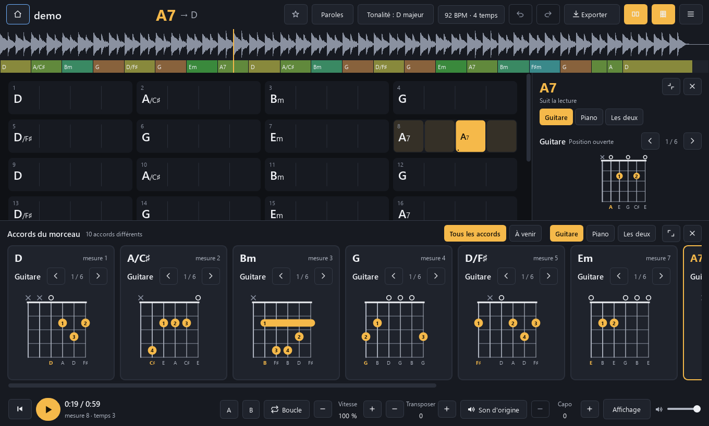
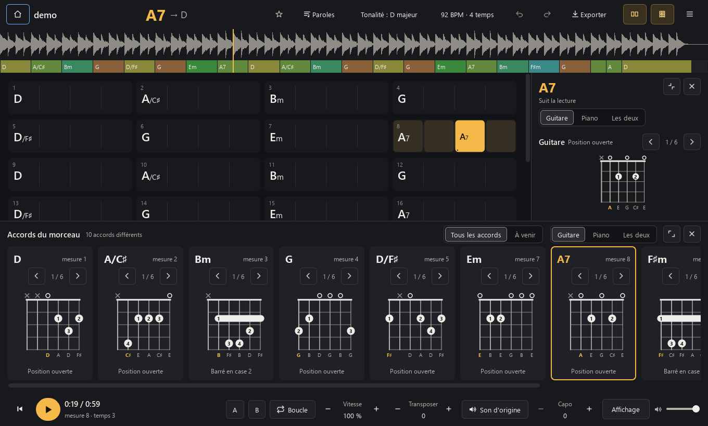
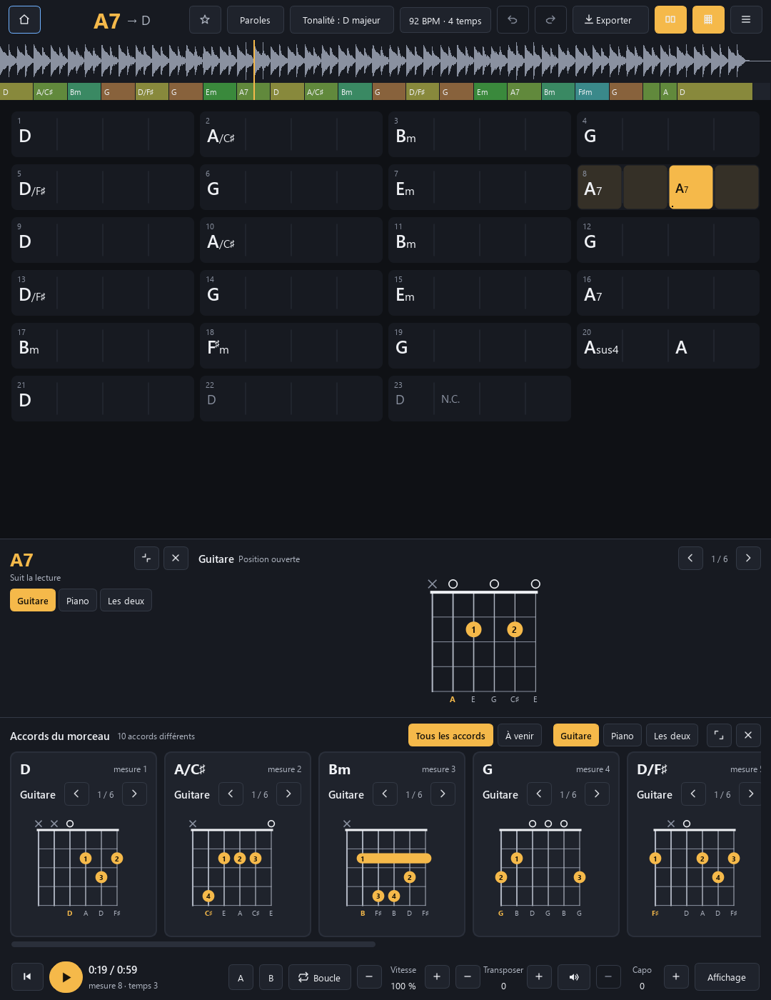
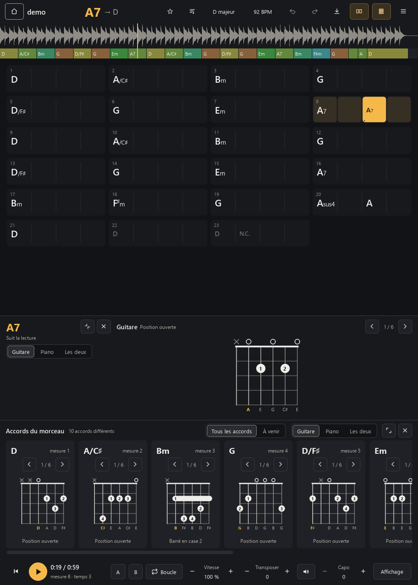
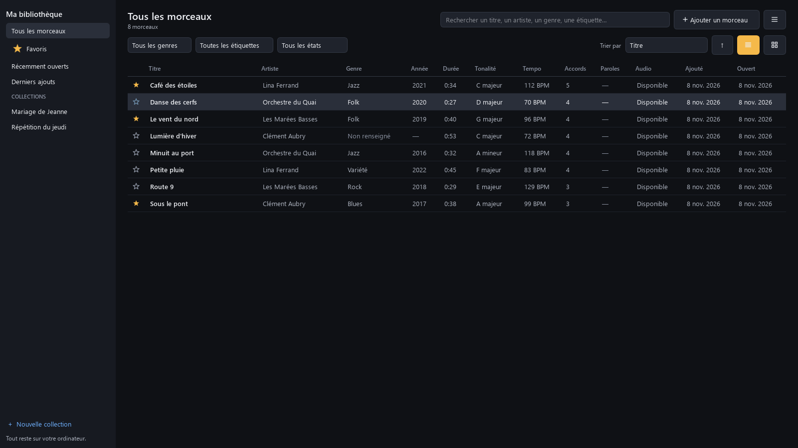
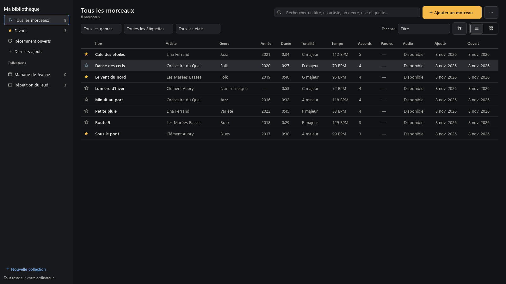
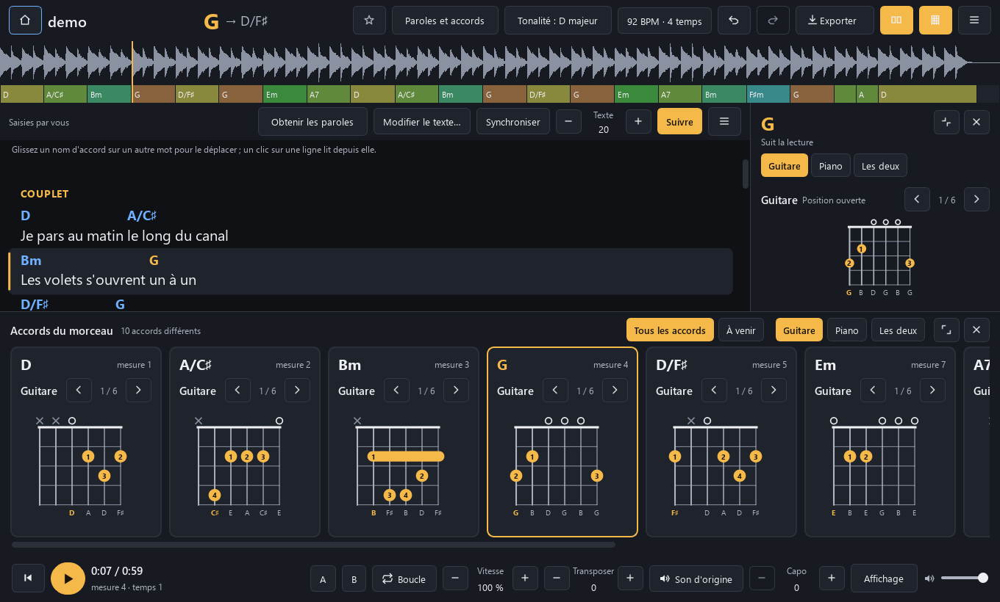
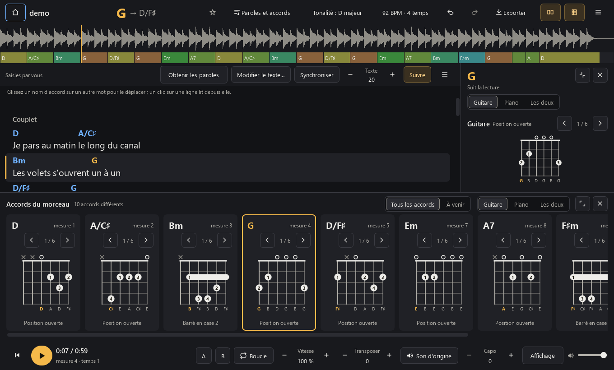

# Le design de LocalChords (depuis la v1.5)

## La direction

Un pupitre sous une lampe de scène : calme, exact, chaleureux. L'ambre éclaire ce qui joue maintenant
(l'accord en cours, le temps, la lecture) et **la seule action principale d'un écran** (« Ajouter un
morceau » dans la bibliothèque). Tout le reste est en graphite chaud, pour que la grille et les
diagrammes soient ce qu'il y a de plus lumineux.

Ce qu'on s'interdit : dégradés décoratifs, verre dépoli, cartes partout, grandes ombres, grands
arrondis, animations sans fonction, icônes de familles différentes, fenêtre sans cadre. La fenêtre reste
une fenêtre Windows normale (barre de titre, ancrage, gestionnaires de fenêtres en mosaïque).

Inspirations, sans dépendance ajoutée : les principes d'[unslop](https://github.com/heydamir/unslop) (CC BY 4.0) sur le
refus des effets génériques, la sobriété de Fluent telle que l'applique [pyside6-fluent-ui](https://github.com/ejacques11/pyside6-fluent-ui) (MIT), et les
règles de [design-engineering-skill](https://github.com/ryktara/design-engineering-skill) (MIT) sur les jetons et la hiérarchie. Aucun code n'en est repris.

## Les jetons

Tout est dans [`src/localchords/ui/theme.py`](../src/localchords/ui/theme.py) : couleurs, tailles de
texte, espacements, rayons, et la feuille de style unique de l'application. Un écran n'écrit jamais de
couleur en dur.

| Rôle | Jeton | Valeur | Contraste |
|---|---|---|---|
| Fond de page | `BG` | `#121316` | |
| Barres et panneaux | `SURFACE` | `#18191D` | |
| Contrôles | `SURFACE_2` | `#202126` | |
| Survol, sélection douce | `SURFACE_3` | `#2B2C32` | |
| Texte | `TEXT` | `#EEEDE9` | 15,9:1 sur le fond |
| Texte secondaire | `TEXT_2` | `#B3B1AA` | 8,7:1 sur le fond, 7,5:1 sur un contrôle |
| Indications, désactivé | `TEXT_3` | `#8E8C85` | 5,5:1 sur le fond |
| Ambre | `ACCENT` | `#F5B94A` | texte sombre dessus : 10,5:1 |
| Interrupteur allumé | `ACCENT_SOFT` + `ACCENT_TEXT` | `#3A3020` / `#FFD48A` | 9,3:1 |
| Sélection et focus clavier | `SELECT` | `#6FB1FF` | |
| Corrigé à la main / boucle / erreur | `EDITED` / `LOOP` / `ERROR` | `#5FD6C6` / `#8F9BFF` / `#FF8A80` | |

Espacement sur une grille de 4 px (4, 8, 12, 16, 24) ; deux rayons (6 et 4 px) ; deux graisses (400 et
600, 700 pour les noms d'accords). Échelle de texte : 12, 13, 15, 17, 20, 30, 32 px. Une seule famille
d'icônes, dessinées au même trait dans `theme.py`.

## Les composants

- **Bouton discret** dans l'en-tête du morceau et pour les boutons à icône seule : sans fond au repos,
  un fond au survol. L'en-tête n'est plus une rangée de boîtes. Un bouton à texte d'une barre de travail
  (lecture, paroles) garde son cadre, comme ses voisins.
- **Bouton principal** en ambre : un seul par écran. Annuler n'en est jamais un.
- **Contrôle segmenté** pour un choix exclusif (Guitare / Piano / Les deux, Tous les accords / À venir,
  liste / cartes) : le choix en cours est plus clair et cerné d'un trait `TEXT_3` (5,5:1 sur le fond).
- **Bascule tonale** pour un interrupteur (panneau latéral, panneau du bas, Suivre) : allumée, elle
  prend une lueur ambre sombre au lieu d'un aplat ambre, qui reste réservé à l'action principale.
- **Focus clavier** : un contour bleu `SELECT` de 1 px sur tous les contrôles ; sur un bouton ambre, un
  contour sombre de 2 px (10,5:1 sur l'ambre).

## Largeur de la fenêtre

La fenêtre tient dès **800 px** de large (environ 1090 px en v1.4), sans réduire le texte ni les zones
cliquables : sous 960 px, annuler/rétablir, exporter et paroles passent en icônes (avec infobulle et nom
accessible) et « Tonalité : » et la mesure se taisent. Sous 1000 px, la barre latérale de la
bibliothèque se resserre. Les mêmes tailles logiques valent à 100, 125 et 150 % : à 150 %, 800 px
logiques font 1200 px à l'écran. Sur un écran court, le panneau des accords du bas cède de la hauteur.
Un test vérifie que chaque barre tient de 800 à 1280 px.

## Avant / après

Mêmes morceaux de démonstration synthétiques, mêmes tailles, rendu hors écran depuis les sources (v1.4
à gauche ou en haut, v1.5 ensuite).

### Le morceau, 1360 × 820

L'ambre n'est plus partout : en v1.4, sept éléments ambre se disputaient l'œil (les deux interrupteurs
de panneau, Guitare deux fois, Tous les accords, l'accord en cours, la lecture). En v1.5, l'accord en
cours et la lecture seulement. Le nom de la position (« Barré en case 2 ») est sous le diagramme.

### Fenêtre étroite

### La bibliothèque, 1600 × 900

### Paroles et accords, 1360 × 820

## Revue indépendante

Une relecture séparée (produit et accessibilité, à partir des captures et du code) a relevé, avant
publication : le focus peu visible sur les boutons ambre, un segment choisi trop peu distinct, le
numéro de case caché par le barré, deux boutons ambre sur l'accueil et pendant l'analyse, des boutons de
barre incohérents, l'infobulle manquante d'« Exporter » réduit à son icône, et la colonne Tempo coupée à
900 px. Tout est corrigé dans la v1.5. Restent, déjà présents en v1.4 : les flèches des champs
numériques peu dessinées (fenêtre Rythme), et les cartes d'accords qui défilent en hauteur quand la
vue Grille et paroles s'ajoute sur un écran de 820 px.

## Accessibilité

- Contrastes : texte 15,9:1, texte secondaire 7,5:1 au moins, indications 4,8:1 au moins (WCAG AA).
- Chaque contrôle qui prend le focus a un nom accessible, y compris les boutons réduits à une icône,
  la grille, le ruban des accords, la liste des morceaux et la boucle.
- L'ordre de tabulation suit l'ordre visuel.
- Rien ne dépend de la couleur seule : l'accord en cours est aussi écrit en grand en haut de l'écran, un accord corrigé porte un point.
- Peu de mouvement : seuls le défilement qui suit la lecture et le court fondu d'un diagramme qui change sont animés.
