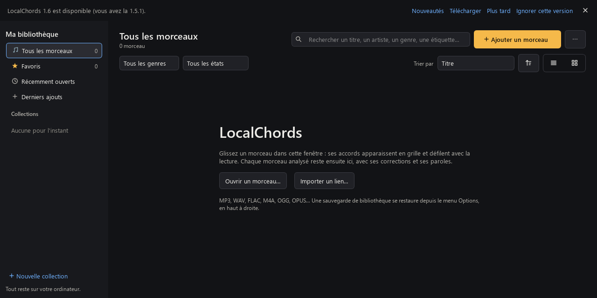

# Mises à jour (1.5.1)

LocalChords peut vous signaler une nouvelle version publiée sur GitHub, la télécharger et la vérifier.
Il ne fait rien de cela sans votre accord, et n'installe jamais rien sans que vous le confirmiez.

*Capture faite avec une version 1.6 simulée.*

## Ce que vous voyez

- **Au premier lancement**, un bandeau demande : « Vérifier les mises à jour au démarrage ? »
  (**Oui, vérifier** / **Non merci**). Tant que vous n'avez pas répondu, rien ne part sur Internet.
- Le choix se change à tout moment dans le menu **⋯** : **Vérifier automatiquement les mises à jour au
  démarrage**. **Rechercher des mises à jour…** fonctionne toujours, même quand la vérification
  automatique est éteinte.
- Quand une version plus récente existe, un bandeau discret s'affiche en haut de la fenêtre. Il ne
  bloque rien : vous pouvez continuer à travailler.
  - **Nouveautés** : les notes de la version, sans images ni contenu distant ; les liens s'ouvrent dans
    votre navigateur.
  - **Télécharger**, avec une barre de progression et **Annuler**.
  - **Plus tard** : le bandeau revient au prochain démarrage.
  - **Ignorer cette version** : plus rien pour cette version-là ; la suivante sera signalée.
- Une vérification lancée à la main dit aussi « LocalChords est à jour » ou pourquoi elle a échoué
  (hors ligne, GitHub injoignable, trop de demandes). Une vérification automatique qui échoue reste
  silencieuse.

## Selon votre façon d'installer

| Vous utilisez | Ce qui est téléchargé | Ensuite |
|---|---|---|
| L'installateur | `LocalChords-Setup-vX.exe`, dans un dossier temporaire à part | **Installer maintenant** demande une confirmation, revérifie le fichier, ferme LocalChords puis lance l'installateur, qui met à jour le même programme (même identifiant d'application). Vos données ne bougent pas. |
| L'exécutable unique | `LocalChords-vX-portable.exe`, **à côté** de celui que vous utilisez | **Lancer la nouvelle version** ou **Ouvrir le dossier**. L'ancien fichier n'est jamais remplacé ni effacé : supprimez-le vous-même quand la nouvelle version vous convient. |
| Le dossier (zip) | `LocalChords-vX-windows-x64.zip`, dans Téléchargements | **Ouvrir le dossier**, et **Comment la mettre en place ?** explique comment remplacer l'ancien dossier. |

L'installation est reconnue par l'entrée de désinstallation de LocalChords dans le registre, qui doit
désigner le dossier du programme en cours. Sinon, le programme est traité comme un exécutable unique ou un
dossier.

**Mode portable** (fichier `LocalChords.portable` à côté du programme) : la nouvelle version est
téléchargée dans le même dossier, pour qu'elle retrouve le même dossier `Data`. Si ce dossier n'est pas
accessible en écriture ou est plein, LocalChords vous demande où l'enregistrer, et vous prévient qu'une
version posée ailleurs ne verra pas ce `Data` tant que vous ne l'aurez pas déplacée à côté. Le dossier
`Data` n'est jamais copié, déplacé ni supprimé.

**Depuis la v1.5** : la v1.5 n'a pas ce système. Pour passer à la v1.5.1, téléchargez-la une fois à la
main sur la [page des versions](https://github.com/tadikwa/LocalChords/releases/latest). Les versions
suivantes vous seront proposées depuis le programme.

## Ce qui part sur Internet

- Une seule demande anonyme à `api.github.com` pour la dernière version publiée : sans compte, sans
  jeton, sans identifiant, sans rien sur vos morceaux. Au plus une fois par jour au démarrage, avec
  l'ETag de la réponse précédente : si rien n'a changé, GitHub répond « inchangé ».
- Puis, seulement quand vous cliquez sur **Télécharger** : `SHA256SUMS.txt` et le fichier choisi, depuis
  les adresses de téléchargement officielles du projet.
- Aucune télémétrie, aucun service, aucune tâche planifiée, rien en arrière-plan une fois LocalChords
  fermé.

Seules sont retenues les versions **publiées et stables** du dépôt `tadikwa/LocalChords` : ni brouillon,
ni préversion, ni nom de version inattendu. Les numéros se comparent nombre par nombre (1.10 est plus
récent que 1.9).

## Vérifications

Avant de garder un fichier, LocalChords vérifie :

1. que l'adresse est celle des fichiers de la version sur `github.com/tadikwa/LocalChords`, et que la
   connexion reste chiffrée (HTTPS) jusqu'au bout ;
2. qu'il reste assez de place sur le disque (taille du fichier et 50 Mo de marge) ;
3. que la taille reçue est exactement celle annoncée ;
4. que son empreinte **SHA-256** est celle que GitHub donne pour ce fichier, **et** celle de
   `SHA256SUMS.txt` publié avec la version. Les deux doivent être présentes et concorder.

Le fichier est écrit en `.part` et ne prend son nom qu'une fois vérifié ; en cas d'échec ou d'annulation,
le morceau téléchargé est effacé. Juste avant d'installer ou de lancer, l'empreinte est **vérifiée de
nouveau** : un fichier modifié entre-temps est effacé et n'est jamais exécuté.

**Ce que ça prouve, et ce que ça ne prouve pas.** Ces vérifications montrent que le fichier est bien
celui publié sur la page du projet, intact. Elles ne prouvent pas *qui* l'a publié : le programme n'est
pas signé. LocalChords ne contourne pas Windows : le fichier porte la même marque « téléchargé depuis
Internet » qu'avec un navigateur, et SmartScreen peut afficher son avertissement comme d'habitude.

Les installateurs déjà appliqués et les téléchargements interrompus sont effacés de son dossier
temporaire (`%TEMP%\LocalChords-mises-a-jour`) au démarrage suivant. Rien d'autre n'est effacé.

## Pour les développeurs

- `src/localchords/updates.py` : vérification, comparaison des versions, cache (ETag, 24 h), choix du
  fichier, téléchargement et vérifications. Sans Qt ; exécuté dans un fil à part.
- `src/localchords/ui/update_banner.py` : bandeau, menu, fenêtre des nouveautés, confirmations.
- Préférences : `update_auto` (absent tant que vous n'avez pas répondu), `update_cache`,
  `update_skip`, `update_ready`.
- `tests/test_updates.py` : réponses de GitHub simulées (brouillon, préversion, 304, 403, 404, hors
  ligne, empreintes absentes ou discordantes, fichier tronqué, redirection en HTTP, annulation), et le
  parcours dans la fenêtre : aucune requête avant l'accord, confirmation avant tout lancement, fichier
  modifié jamais lancé, dossier `Data` intact.
